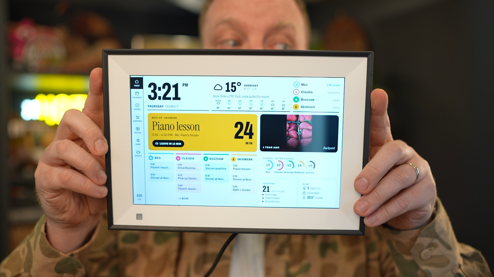

# Taking over Android photo frames

Turn a cheap Android photo frame into a family dashboard: unlock it, root it, replace the vendor app, and run your own web page full screen.

**TLDR:** buy a $50 frame, point an agent at this repo and let 'er rip!

[](https://youtu.be/ZLycoUMltNI)

▶️ **Watch the video: [https://youtu.be/ZLycoUMltNI](https://youtu.be/ZLycoUMltNI)**

## Working frames

<a href="https://amzn.to/4zneGNM"></a>
<a href="https://amzn.to/4B38DQ0"></a>
<a href="https://amzn.to/4zwU6e0"></a>
<a href="https://www.amazon.com/dp/B0CQN2PKQR?tag=webo080-20"></a>
<a href="https://www.amazon.com/dp/B0D8J5PNFH?tag=webo080-20"></a>
<a href="https://www.amazon.com/dp/B0C9V811L6?tag=webo080-20"></a>
<a href="https://www.amazon.es/dp/B0GGB7LWX8"></a>
<a href="https://www.amazon.ca/dp/B0H4W1YPHH"></a>

Frames confirmed to work (Amazon affiliate links). See the **[device index](docs/devices.md)** for every
frame, which board it has, and where to start.

## Community builds

More than 70 people have shared their hacked frames in [Community builds](docs/community-builds.md): LCARS
interfaces, retro weather channels, chess puzzles, Linux on a frame, family dashboards and more.

<a href="docs/community-builds.md"></a>
<a href="docs/community-builds.md"></a>
<a href="docs/community-builds.md"></a>
<a href="docs/community-builds.md"></a>
<a href="docs/community-builds.md"></a>
<a href="docs/community-builds.md"></a>

Notes and scripts from getting full control of locked-down Android photo frames: getting ADB,
backing up the firmware, getting root, removing the vendor app, and running our own launcher,
browser and kiosk app. These are records of the units their owners tested, not universal flashing
guides.

## Which frame do you have?

Frames sold under the same name, even the same Amazon listing, can have different boards. Check
Settings → About before you follow any guide:

- **PF1007L / AiMOR** (firmware string contains `A33` and `PF1007L`): Allwinner A33. Many viewers of
  the video got this one. Use a **USB-A to USB-C** data cable; USB-C to USB-C gives no power or data.
  Start with [pf1007l-start-here.md](docs/pf1007l-start-here.md). It tests
  ADB over USB, then the network, and only then a boot patch. Its vendor app accepts root shell
  commands from the vendor's server, so read that page before the frame goes online.
- **BIUFRAME / Synergy 10X1** (Rockchip RK3126, ADB prompt on screen): the frame in the video. Follow
  [biuframe-setup-guide.md](docs/biuframe-setup-guide.md). `scripts/biuframe-setup.sh check`
  changes nothing and confirms the hardware matches; `backup` and `apply` do the rest.
- **Skylight Calendar 150-CAL** (Rockchip RK3566): start with [next-session.md](docs/next-session.md),
  then [app-analysis.md](docs/app-analysis.md) for the hidden menu. The manufacturer code is
  intentionally not published; the doc shows where the app checks it. Check Settings → About
  first: firmware `D156.V0.10` ships with ADB and `su` on ([skylight-d156.md](docs/skylight-d156.md)).
- **LOOFII C-3 21.5" calendar** (Allwinner A133, Android 10): root ADB over USB out of the box. See
  [allwinner-a133-loofii-c3.md](docs/allwinner-a133-loofii-c3.md); don't run the Rockchip or A33 scripts on it.
- **Frameo, Dragon Touch, Joyhong, Uhale, VESWWE, Pastigio and others:** see the
  [device index](docs/devices.md).
- **Something else:** work through the [phase map](#phase-map), create `docs/<device>.md`, and
  [send in what you find](#check-for-updates-and-send-back-what-you-find).

## The dashboard

[`dashboard/`](dashboard) is the family dashboard we run on the BIUFRAME (it uses mock data): a Vite
web app deployed to Cloudflare Workers. `dashboard/kiosk/` is a small full-screen WebView Android app,
built without Gradle, that shows it. Hold two fingers still for 1.5 s to open a menu for the
launcher, Android settings, and reloading. On frames without system navigation, optional floating
**Back** and **Dashboard** buttons help; see the [kiosk guide](dashboard/kiosk/README.md).

## For agents: start here

You are probably helping someone with a similar device plugged into a Mac over USB. Read this
section, then follow the links for the phase you are in. Do not run anything from a device
section unless the identity checks match exactly.

### Rules we learned the hard way

1. **Ask the owner before every write.** Reads are fine. Writing flash, a partition, `/system`,
   or sending a RAM payload to the SoC needs explicit approval for that specific action.
2. **No writes before a verified backup**: exact byte count, SHA-256, gzip readback, a check for
   `0xCC` filler, and independent re-reads of a few partitions that match.
3. **Don't trust `OKAY`.** Fastboot reported a successful boot write on the Skylight that never
   took effect. Verify writes by reading them back and checking the result on the device.
4. **Stop at the first mismatch** in a hash, model string, offset or size. Report it rather than
   working around it.
5. **One change at a time, undo recorded first.** Keep `.bak` copies next to edited files.
6. **Pin downloads by SHA-256** from official sources (vendor archives, F-Droid, LineageOS, GitHub releases).
7. **Keep dumps private.** They contain Wi-Fi passwords, tokens, serials, MAC addresses and
   copyrighted firmware. Use the ignored `backups/` and `diagnostics/` folders. Leave unique
   identifiers out of anything you commit.
8. **Write notes as you go.** Keep a per-device file in `docs/`, like the ones in the
   [device index](docs/devices.md), with
   observations kept separate from guesses.
9. **Prove the way back before you close the way in.** Before you disable the app or route your
   access came through, or end an access session, check by hand on the panel that your kiosk can
   reach Android Settings → Apps. An `input tap` or `screencap` over ADB does not prove it. A
   PF1007L was locked out this way; see
   [the lockout notes](docs/pf1007l-20260410-network-adb.md#6-lockout-after-disabling-aimor-and-offline-recovery). Some
   builds hide disabled apps in Settings, so keep a second way in, such as persistent ADB.

### Check for updates, and send back what you find

Many people are working on these frames at the same time. New hardware variants, fixes and
routes arrive as issues and pull requests, often before they are merged. Your local copy may be
out of date.

**Check before you start, and again before each write and at the start of each new session:**

```sh
git fetch origin && git log --oneline HEAD..origin/main   # new commits on main
gh issue list --repo wesbos/photo-frame-dashboard --state all --limit 30
gh pr list --repo wesbos/photo-frame-dashboard --state all --limit 30
gh pr view <number> --repo wesbos/photo-frame-dashboard   # read anything about your device
gh pr diff <number> --repo wesbos/photo-frame-dashboard
```

Without `gh`, use <https://github.com/wesbos/photo-frame-dashboard/issues> and
<https://github.com/wesbos/photo-frame-dashboard/pulls>. Read open PRs about your device, not only
merged docs. If newer information contradicts these docs, tell the owner and follow the newer
information only after its checks pass on your unit. Unmerged PRs are less reviewed, so treat their
scripts with extra care.

**Send a pull request when you learn something new** about a device that is already documented or
about a new one. Examples: a new board or firmware string, a different boot image hash, a cable or
port that does or does not work, a step that failed, a better route, or a correction. Failed
attempts are useful too.

1. Check open issues and PRs first. If one already covers your finding, comment there instead.
2. Create a branch, and add your observations to the device doc in `docs/`. For a new device,
   create `docs/<device>.md`. Keep observations separate from guesses, and say which host OS and
   which unit you used.
3. Remove private data: serials, MAC addresses, Wi-Fi details, eMMC CIDs, tokens, whole-disk
   hashes, dumps and vendor APKs. Firmware strings and boot image hashes are fine.
4. Show the owner the diff, because the PR is published under their GitHub account. Then open it
   with `gh pr create --repo wesbos/photo-frame-dashboard`.

For a PF1007L, include the [report template](docs/pf1007l-start-here.md#report-your-unit).

### Keep a private record of each frame

Keep what you changed on the owner's frame, where the backups are and how to undo it in the
ignored `frames/` folder, and read it at the start of the next session. Re-check the frame before
trusting it, and remember that a past approval is not permission for a new write. See
[frame-records.md](docs/frame-records.md).

### Phase map

| Phase                        | What to read                                                                                                                                                                                                                                                                                                                                                                                                                                                                                                                                                                                     |
| ---------------------------- | ------------------------------------------------------------------------------------------------------------------------------------------------------------------------------------------------------------------------------------------------------------------------------------------------------------------------------------------------------------------------------------------------------------------------------------------------------------------------------------------------------------------------------------------------------------------------------------------------ |
| **1. Identify** the hardware | USB IDs (Rockchip is VID `2207`), `adb shell getprop`, chip query in loader mode. See the hardware tables in [biuframe.md](docs/biuframe.md#hardware-and-ports) and [hardware-research.md](docs/hardware-research.md).                                                                                                                                                                                                                                                                                                                                                                           |
| **2. Get ADB**               | Try in this order: **(1) over USB** (`adb devices`; accept any "Allow USB debugging" prompt on the screen), **(2) over the network** (`adb connect <ip>:5555`), **(3) only then** a vendor-app trick or a boot patch. The PF1007L boot patch is written from an SD card, see [pf1007l-start-here.md](docs/pf1007l-start-here.md#test-sequence). Ideally no one needs (3). For a vendor-app trick, decompile the vendor app (jadx) and look for hidden tap counters and code dialogs: [app-analysis.md](docs/app-analysis.md). Gestures that did _not_ work are in [research-log.md](docs/research-log.md#ui-attempts-that-did-not-work).                                                                                                                                                                                                                                                                       |
| **3. Loader mode**           | Skylight: hold Volume − while connecting power. BIUFRAME: reset button at power-on (unconfirmed). Building `rkdeveloptool` on Apple silicon: [research-log.md](docs/research-log.md#loader-mode--successful).                                                                                                                                                                                                                                                                                                                                                                                    |
| **4. Back up**               | If loader reads past 32 MiB return `0xCC` filler, they are not a backup: [loader-research.md](docs/loader-research.md). Patched helper and full capture: `scripts/patch-usb-reader.py`, `scripts/load-usb-reader.py`, `scripts/probe-reader.py`, `scripts/backup-flash.py`, `scripts/inspect-backup.py`. With root, back up over ADB instead: `scripts/biuframe-setup.sh backup`.                                                                                                                                                                                                                |
| **5. Root**                  | First check for a shipped `su` (`adb shell su -c id`). On Android 10+ user builds, try the debug-ramdisk route: [debug-ramdisk-research.md](docs/debug-ramdisk-research.md), `scripts/build-debug-boot.py`. Fastboot write failures: [ram-boot-research.md](docs/ram-boot-research.md).                                                                                                                                                                                                                                                                                                          |
| **6. Make it useful**        | Launcher: [android-launcher.md](docs/android-launcher.md). Old Android (6.x) with a browser, WebView swap, CA roots, swap, nav bar and disabling vendor apps: [biuframe-setup-guide.md](docs/biuframe-setup-guide.md). Kiosk app and launcher database edits: [biuframe.md](docs/biuframe.md#custom-webview-kiosk-app-2026-09-30). A working example of a kiosk app and dashboard is in [`dashboard/`](dashboard). Build with `dashboard/kiosk/build.sh` (macOS/Linux) or `dashboard/kiosk/build.ps1` (Windows), change `DEFAULT_URL` in `MainActivity.java` to your own URL, and target the device's WebView version (see `dashboard/vite.config.js`). |
| **7. Networking**            | USB reverse tethering with gnirehtet: [usb-internet-sharing.md](docs/usb-internet-sharing.md). An app that requires Wi-Fi specifically: [onboarding-network-gate.md](docs/onboarding-network-gate.md). Dead onboard Wi-Fi and a USB dongle: [usb-wifi-dongle.md](docs/usb-wifi-dongle.md).                                                                                                                                                                                                                                                                                                       |
| **8. Vendor updates**        | Connecting the stock app to the internet can auto-install APK updates: [app-updates.md](docs/app-updates.md). Disable vendor updaters (FOTA etc.) before going online.                                                                                                                                                                                                                                                                                                                                                                                                                           |
| **9. Security hand-off**     | Tell the owner what they now have: [biuframe-setup-guide.md](docs/biuframe-setup-guide.md#read-this-first).                                                                                                                                                                                                                                                                                                                                                                                                                                                                                      |

## Other docs

- [Recovery catalog](docs/recovery/README.md): model/variant records, contribution template and backup prompt
- Skylight Wi-Fi investigation: [live-diagnostics.md](docs/live-diagnostics.md),
  [native-wifi-root-tests.md](docs/native-wifi-root-tests.md),
  [wifi-firmware-candidate.md](docs/wifi-firmware-candidate.md),
  [recovery-wifi-diagnostics.md](docs/recovery-wifi-diagnostics.md),
  [device-test-wifi.md](docs/device-test-wifi.md), [static-iw.md](docs/static-iw.md)
- Skylight boot and recovery: [boot-analysis.md](docs/boot-analysis.md),
  [recovery-analysis.md](docs/recovery-analysis.md)
- Replacing Android: [android-replacement.md](docs/android-replacement.md),
  [android14-dsu.md](docs/android14-dsu.md) (Android 14 GSI trial through DSU)
- [external-networking.md](docs/external-networking.md)

## Privacy

`backups/`, `diagnostics/`, `log/`, loader query output and machine-local settings are excluded by
`.gitignore`. They hold full flash dumps, decompiled vendor code, signing keys, and the unit's
identifiers. Do not commit them, and do not publish dumps or vendor APKs.
