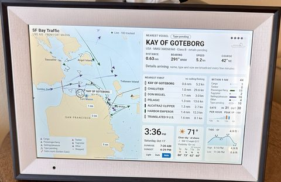

# Community builds

After the video, a lot of people hacked their own frames, and shared what they put on them. Here are
the ones we've seen so far, newest first. Tap a build to see the original post.

Built one? Add it in a pull request (one row, a link to your post, and optionally a small photo in
`docs/images/community/`), or open an issue. If you unlocked a frame that isn't in the
[device index](devices.md), please [send in what you found](../README.md#check-for-updates-and-send-back-what-you-find).

## Hacked photo frames

| Build&nbsp;&nbsp;&nbsp;&nbsp;&nbsp;&nbsp;&nbsp;&nbsp;&nbsp;&nbsp;&nbsp;&nbsp;&nbsp;&nbsp;&nbsp;&nbsp;&nbsp;&nbsp;&nbsp;&nbsp;&nbsp;&nbsp;&nbsp;&nbsp;&nbsp;&nbsp;&nbsp;&nbsp;&nbsp;&nbsp;&nbsp;&nbsp;&nbsp;&nbsp;&nbsp;&nbsp;&nbsp;&nbsp;&nbsp;&nbsp; | Who |
| --- | --- |
|  [SF Bay ship tracker: live AIS map from Fort Mason with bridges and range rings, tap a ship for details, Golden Gate crossing counts, shore weather and tides, on a PF1007L rooted with Route U on macOS](https://github.com/wesbos/photo-frame-dashboard/issues/172) | [@ejosowitz](https://github.com/ejosowitz) |
|  [Bin-day and weather screen](https://x.com/dwkns/status/2110138322894860377) | [@dwkns](https://x.com/dwkns) |
| [$19.99 frame](https://x.com/itsyigitgungor/status/2110138004614353316), rooted with the [Uhale SI006 guide](si006-uhale.md) | [@itsyigitgungor](https://x.com/itsyigitgungor) |
|  [Root shell on an Amazon frame](https://x.com/_KevinTang/status/2110133721798172829) | [@_KevinTang](https://x.com/_KevinTang) |
|  [USB debugging on out of the box; teletext-style news screen](https://x.com/reecechown/status/2110132394573414434) | [@reecechown](https://x.com/reecechown) |
|  [15-inch frame: school-morning agenda, HomePod time alerts, calendar and weather radar](https://x.com/0xBOYD/status/2110117477413970048) | [@0xBOYD](https://x.com/0xBOYD) |
|  [Working $50 frame dashboard](https://x.com/software_chef/status/2110113979439927740) | [@software_chef](https://x.com/software_chef) |
| [Doorbell, stock alerts, calendar, to-dos, meal planning, weather and birthdays](https://x.com/flip4liberty/status/2110093518618144862) | [@flip4liberty](https://x.com/flip4liberty) |
| [Working build](https://x.com/sebflorent/status/2110075527503454456) | [@sebflorent](https://x.com/sebflorent) |
|  [Photo, weather and status dashboard](https://x.com/swpknl/status/2110059078882075095) | [@swpknl](https://x.com/swpknl) |
|  [House screen on Cloudflare Workers, D1, R2 and Workers AI: calendars, chores, meals, pantry, receipt scanning, Home Assistant and Spotify](https://x.com/rchandra_sekar/status/2110054361594470841) | [@rchandra_sekar](https://x.com/rchandra_sekar) |
|  [Home Assistant display, replacing a Fire HD 8](https://x.com/TomC20924637/status/2110047626788057543) | [@TomC20924637](https://x.com/TomC20924637) |
|  [15-inch frame app: calendar, to-dos, climate, lights, music, photos and a cat feeder](https://x.com/AnalogAutoHaus/status/2110040841133695471) | [@AnalogAutoHaus](https://x.com/AnalogAutoHaus) |
|  [Async chess and a house shopping list](https://x.com/JDArmada/status/2110040131835224299) | [@JDArmada](https://x.com/JDArmada) |
| [Custom U-Boot, eMMC reads at 12 MHz and a boot-image patch on an Allwinner A33 frame, from WSL](https://x.com/sevenmaison/status/2110040012918018130) | [@sevenmaison](https://x.com/sevenmaison) |
|  [Dashboard in progress](https://x.com/TMartinPPC/status/2110031060092289121) | [@TMartinPPC](https://x.com/TMartinPPC) |
|  [Snoopy clock and weather screen](https://x.com/lucataco/status/2110022587271258308) | [@lucataco](https://x.com/lucataco) |
|  [Frame mounted in a home gym](https://x.com/JanMilberg/status/2109993684636995997) | [@JanMilberg](https://x.com/JanMilberg) |
|  [Family calendars, notifications and lists through Dot and OpenClaw](https://x.com/alex_marples/status/2109965150945956280) | [@alex_marples](https://x.com/alex_marples) |
| [Velaro dashboard walkthrough (video)](https://x.com/simeonGriggs/status/2109942992857354387) | [@simeonGriggs](https://x.com/simeonGriggs) |
| [Fixed boot issues (and sent a PR); friends can push updates to the frame](https://x.com/_manboy_/status/2109888220637049001) | [@_manboy_](https://x.com/_manboy_) |
|  [FamilyLink Extolink frame running the web dashboard](https://x.com/DanielGlenn/status/2109868079643807891) | [@DanielGlenn](https://x.com/DanielGlenn) |
|  [Universal remote for the house's Samsung TVs, with themes](https://x.com/PeterChacon30/status/2109867771987378629) | [@PeterChacon30](https://x.com/PeterChacon30) |
|  [Calendar, front-door camera, lights, music and weather](https://x.com/flyfisher15/status/2109852858266902850) | [@flyfisher15](https://x.com/flyfisher15) |
|  [Birthday gift: family events nearby, sports teams, chores and a pregnancy tracker that turns into a feeding log](https://x.com/bprintco/status/2109850221110792485) | [@bprintco](https://x.com/bprintco) |
|  [Family dashboard with a whose-turn-for-the-dishes switch](https://x.com/SourdeathSam/status/2109844538613473779) | [@SourdeathSam](https://x.com/SourdeathSam) |
|  [Animal Crossing-style menu](https://x.com/JJCamacho08/status/2109842427355726011) | [@JJCamacho08](https://x.com/JJCamacho08) |
|  [No-name Amazon frame reset over ADB, running an app that shows a Cloudflare Workers dashboard](https://x.com/Marat_Galiev/status/2109835994270716010) | [@Marat_Galiev](https://x.com/Marat_Galiev) |
|  [$34 frame on the wall](https://x.com/Jairomeie/status/2109833161815236628) | [@Jairomeie](https://x.com/Jairomeie) |
|  [Personal dev frame for checking in on projects](https://x.com/heygrexbot/status/2109822226136465478) | [@heygrexbot](https://x.com/heygrexbot) |
| [$40 frame to a rooted home dashboard in 21 minutes](https://x.com/ezramechaber/status/2109813915500851705) | [@ezramechaber](https://x.com/ezramechaber) |
|  [Svelte dashboard with Todoist and iCloud](https://x.com/huntsyea/status/2109813483378262360) | [@huntsyea](https://x.com/huntsyea) |
|  [Home Assistant living-room dashboard with a custom boot screen](https://x.com/martinwoodward/status/2109794375618490770) | [@martinwoodward](https://x.com/martinwoodward) |
|  [Kids' routine screen: bedtime, calming corner and photos](https://x.com/montrellcruse/status/2109786028714446921) | [@montrellcruse](https://x.com/montrellcruse) |
| [Case open and Codex pointed at this repo within 10 minutes of delivery](https://x.com/LeonardVolner/status/2109785163475591510) | [@LeonardVolner](https://x.com/LeonardVolner) |
|  [15-inch frame as an AI home dashboard](https://x.com/lafraia/status/2109784141302563027) | [@lafraia](https://x.com/lafraia) |
|  [Hardening notes for the Allwinner A33 frame (thread)](https://x.com/NeoElevate_/status/2109761532213223518) | [@NeoElevate_](https://x.com/NeoElevate_) |
|  [Family calendar display](https://x.com/Zack_Laffey/status/2109761430467523041) | [@Zack_Laffey](https://x.com/Zack_Laffey) |
| [Rooted](https://x.com/EdCharbeneau/status/2109754685569613953) | [@EdCharbeneau](https://x.com/EdCharbeneau) |
|  [Photo matching game for the family](https://x.com/5cheeseburgers/status/2109748242561081605) | [@5cheeseburgers](https://x.com/5cheeseburgers) |
| [Grok Bot usage on a frame dashboard](https://x.com/BowieHole/status/2109738657116491864) | [@BowieHole](https://x.com/BowieHole) |
|  [Agent usage dashboard, installed with Codex and Claude](https://x.com/jk22262/status/2109713402792906902) | [@jk22262](https://x.com/jk22262) |
|   [Home security station on a PF1007L: three Wyze cameras live and a 7-day recording timeline with person and vehicle events](https://x.com/moeealii) | [@moeealii](https://x.com/moeealii) |
|  [Frame running an Executor v2 metrics dashboard; offering them to YC founders](https://x.com/RhysSullivan/status/2109459855383941423) | [@RhysSullivan](https://x.com/RhysSullivan) |
|  [Native Android client/server app instead of a browser dashboard](https://x.com/alanb/status/2109581321584668735) [Now open source as Mado: a painting-of-the-day dashboard, alerts and an MCP server for agents](https://github.com/abradburne/mado) [Added a little buddy and weather pages](https://x.com/alanb/status/2109823529705451623) | [@alanb](https://x.com/alanb) |
|  [Chess puzzles, web analytics, home camera view, video streaming](https://x.com/tushargugnani/status/2109659313421853176) | [@tushargugnani](https://x.com/tushargugnani) |
|  [Screensaver with info, lighting controls, lock status](https://x.com/BtcPins/status/2109435304935567733) | [@BtcPins](https://x.com/BtcPins) |
| [Frame build](https://x.com/antdotvgr/status/2109612664846418082) | [@antdotvgr](https://x.com/antdotvgr) |
|  [Grok Bot on a photo frame as a voice assistant](https://x.com/tomnagengast/status/2109441743884312930) | [@tomnagengast](https://x.com/tomnagengast) |
|  [Family dashboard rooted and built with Codex, hosted on Hetzner](https://x.com/rida/status/2109630806805123487) | [@rida](https://x.com/rida) |
|  [Shared calendar, events and photo slideshow with screensaver](https://x.com/BTCJohnnyB/status/2109481752016146828) | [@BTCJohnnyB](https://x.com/BTCJohnnyB) |
|  [Working build using the repo's microSD workarounds](https://x.com/nicholasmackey/status/2109478338410742084) | [@nicholasmackey](https://x.com/nicholasmackey) |
|  [Omarchy Linux running natively on an Allwinner A33 frame](https://x.com/redp314/status/2109699021799293244) [SD-image builder and installer (third-party)](https://github.com/pangoleen/ormarch-picture-frame/tree/a3d83874aabcae655f245973e6408937a591e39f) | [@redp314](https://x.com/redp314) |
|  [Up and running](https://x.com/pideson/status/2109476146228199697) | [@pideson](https://x.com/pideson) |
|  [Home Assistant dashboard frame for kids and guests](https://x.com/ScriptedPixels/status/2109585535958183995) | [@ScriptedPixels](https://x.com/ScriptedPixels) |
|  [Rooted Android 6 frame as a family kitchen dashboard](https://x.com/tborges77/status/2109649672063123806) | [@tborges77](https://x.com/tborges77) |
|  [Amazon Mexico frame (Digital Photo Frame 102k) working](https://x.com/_charlie632/status/2109493591911309523) | [@_charlie632](https://x.com/_charlie632) |
|  [Rooted a Frameo 114k with no USB ADB and published instructions on GitHub](https://x.com/pmikolajczuk89/status/2109460981923656022) | [@pmikolajczuk89](https://x.com/pmikolajczuk89) |
|  [Frame working within an hour of the video](https://x.com/cpenned/status/2108554770827084031) [It works, and now the family wants one too](https://x.com/cpenned/status/2109302416269295694) | [@cpenned](https://x.com/cpenned) |
|  [BotFrame arrived](https://x.com/xenappblog/status/2109382318901359049) [BotFrame dashboard built before the frame arrived; scans products from iPhone](https://x.com/xenappblog/status/2109299007705207212) [BotFrame MCP: agents send notifications over a Cloudflare tunnel](https://x.com/xenappblog/status/2110006393612702108) | [@xenappblog](https://x.com/xenappblog) |
| [Late-night v1, built with Claude](https://x.com/peterramsing/status/2109169838577070098) | [@peterramsing](https://x.com/peterramsing) |
|  [Smart-home dashboard with air-quality monitor](https://x.com/ShaikhAliAkbar/status/2109179706683838474) | [@ShaikhAliAkbar](https://x.com/ShaikhAliAkbar) |
|  [Star Trek TNG LCARS interface on a hacked Amazon photo frame](https://x.com/JesseWaites/status/2109394924265144483) | [@JesseWaites](https://x.com/JesseWaites) |
|  [Retro 90s weather-channel display (ws4kp): weather, radar, snow report, Immich album, Google Calendar](https://bsky.app/profile/derekparks.dev/post/3mxmtav5pqk2t) | [@derekparks.dev](https://bsky.app/profile/derekparks.dev) |
|  [Rooted smoothly; looking for a use case](https://x.com/mikouaji/status/2109223058024116705) | [@mikouaji](https://x.com/mikouaji) |
| [Spent a day building one and contributed back to this repo](https://x.com/CalEvans/status/2109385254196924785) | [@CalEvans](https://x.com/CalEvans) |
| [Frame for in-laws in their 80s that the grandkids update remotely](https://x.com/natesiggard/status/2109294097680957574) | [@natesiggard](https://x.com/natesiggard) |
|  [FamilyOS: open-source family organizer with a frame display view](https://x.com/onurceri/status/2109392956075508074) | [@onurceri](https://x.com/onurceri) |
| [Rooted a different model (RK312x, Android 6) after disabling Frameo](https://x.com/CamberNorth/status/2109315560463114324) | [@CamberNorth](https://x.com/CamberNorth) |
| [Getting started on a build](https://x.com/lito_ordes/status/2108914419514376252) | [@lito_ordes](https://x.com/lito_ordes) |
| [Frame conversion build, compared to the HP TouchPad fire sale](https://x.com/artificialmusik/status/2109029107082342685) | [@artificialmusik](https://x.com/artificialmusik) |
|  [$50 frame working; tuning speed and the address bar](https://x.com/nearbycoder/status/2108674711332798652) | [@nearbycoder](https://x.com/nearbycoder) |
| [Office display build inspired by the video](https://x.com/TasonJorres/status/2108583886162985052) | [@TasonJorres](https://x.com/TasonJorres) |
