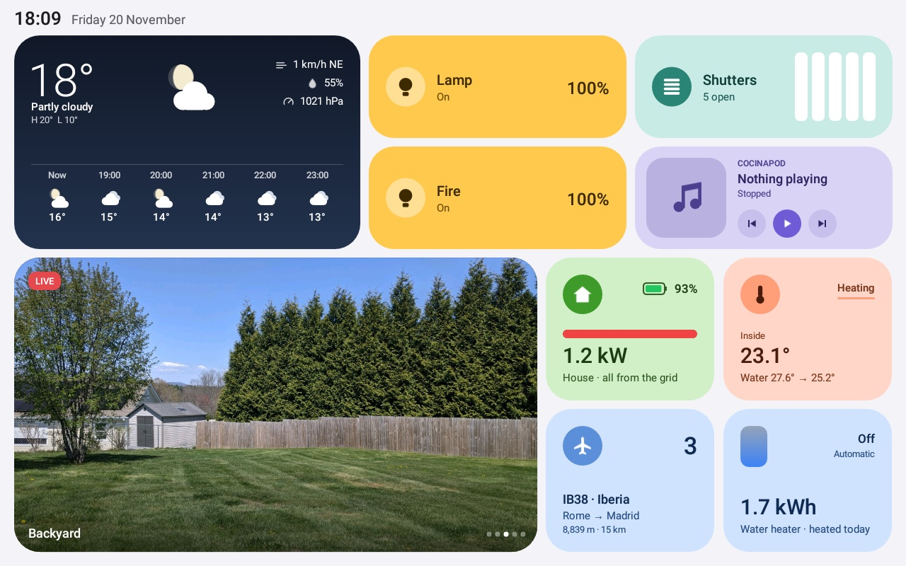
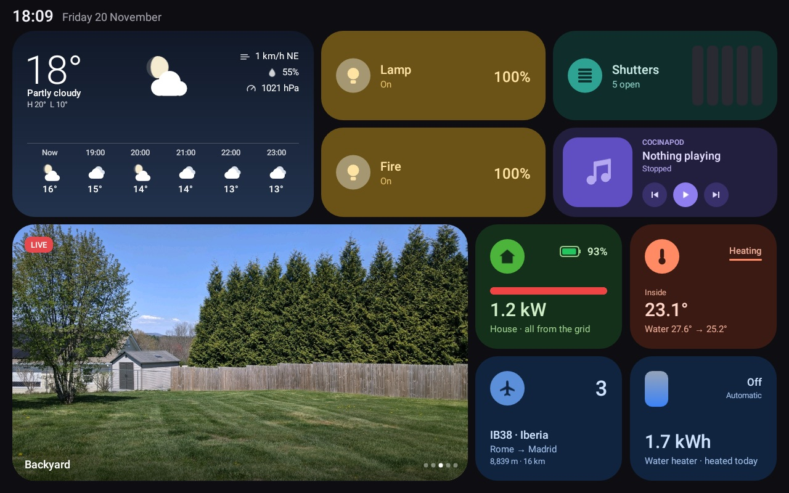
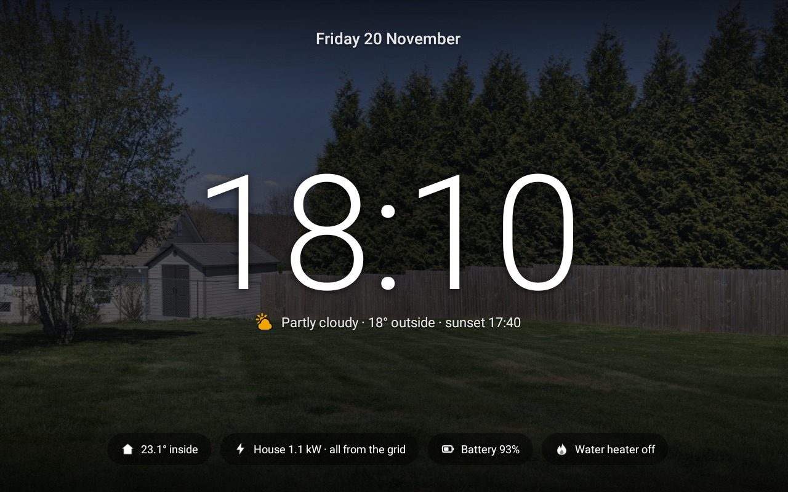

# Denver PFF-1053 10.1" Frameo frame (RK3126, Android 6.0.1, firmware `D101_KJM_BND_20230906`)

Record of one unit, set up on macOS 27.2 (Apple silicon, platform-tools 34.0.5) on 2026-11-19 and
2026-11-20. Observations are kept separate from guesses. Unique identifiers (serial, MAC, Wi-Fi
name) are left out; they stay in the owner's private backup folder.

**Result:** ADB over USB from Frameo's own settings, a shipped SuperSU `su`, a backup of every
partition before `userdata` plus a file-level copy of `/data`, and a native Home Assistant
dashboard app as the Home app with Frameo disabled. Network ADB on 5555 survives reboots. Nothing
was written to `/system` or a boot partition.

(The camera tile shows a public-domain stand-in picture, not the owner's camera.)

## How it relates to the known RK3126 frames

Sold as the white **PFF-1053W**; Android calls itself `Denver PFF-1053B BLACK`, so the black and white
frames look like the same device. It is **not** a ZhiHeXing build like the
[PFF-1015](denver-pff-1015.md), [PFF-1024BMK2](denver-pff-1024bmk2.md) and
[PFF-1021BMK3](denver-pff-1021bmk3.md): the manufacturer string is `KJM-BND`, the FOTA OEM is
`szbndRK3126_6.0`, and storage is **rknand** (`/dev/block/rknand_*`), not `mmcblk0`. It has 512 MB
like the older Denver frames, but no low-RAM mode.

## Identity

| | |
| --- | --- |
| Sold as | Denver PFF-1053W, Frameo 10.1" (white). Frameo v1.32.18 |
| `ro.product.model` / `brand` / `manufacturer` | `Denver PFF-1053B BLACK` / `Denver` / `KJM-BND` |
| `ro.product.name` / `device` | `Denver PFF-1053B BLACK` / `Denver PFF-1053B BLACK` |
| `ro.product.board` / `board.platform` / `hardware` | `rk30sdk` / `rk312x` / `rk30board` |
| `ro.rk.soc` | `rk3126` |
| Build fingerprint | `rockchip/rk312x/rk312x:6.0.1/MXC89K/user.zcx.20230906.170016:user/release-keys` |
| Display ID | `D101_KJM_BND_20230906`, built 2023-09-06 |
| Android | 6.0.1, API 23, security patch 2019-11-05, kernel 3.10.0 |
| `ro.build.type` / `ro.secure` / `ro.debuggable` / `ro.adb.secure` | `user` / `1` / `0` / `1` |
| SELinux | permissive |
| `ro.config.low_ram` | not set |
| FOTA strings | `ro.fota.oem=szbndRK3126_6.0`, `ro.fota.platform=RK3126_6.0` (`com.adups.fota` runs) |
| Storage | rknand, 13 partitions (below); `/data` 13.2 GB |
| RAM / swap | 502,780 kB / 128 MB zram |
| Display | 1280x800, 160 dpi (1 dp = 1 px), `ro.sf.hwrotation=90`, landscape |
| WebView | `com.android.webview` **44.0.2403.119** |
| ABI | `armeabi-v7a,armeabi` |
| Disabled out of the box | `com.android.systemui`, `com.android.launcher3` (this setup did not disable them) |
| Sensors | touch, an accelerometer (`sc7a30`), buttons Vol −/+ and Wake. Proximity, light, pressure and temperature are listed but deliver nothing. No camera, microphone or motion sensor |
| Power | USB-C. It keeps running from a computer's USB port alone. `dumpsys battery` says `present: true` with `voltage: 0`; whether there is a real battery was not checked |
| Size | about 264 x 183 x 26 mm, about 1.2 kg, from shop listings (not measured) |

## Getting ADB and root

1. On the frame: Frameo **Settings → About → Beta Program → ADB access**.
2. Connect a **USB-A to USB-C** data cable.
3. An **"Allow USB debugging?"** prompt showed on the frame; after accepting it, `adb devices -l`
   listed it as `device`. A second computer was not tried.
4. **Root is shipped:** SuperSU 2.45, `/system/xbin/su` with `daemonsu` running as root. `adb shell
   su -c id` answered `uid=0(root)` with no prompt.

**No `iotv`.** There is no `/system/bin/iotv` and no `iotv` process. Init services were not listed.

**`/system` remounted every ~5 s while Frameo ran.** The mount count and timestamps in the ext4
superblock kept changing, so two reads of `system` never hash the same (see Backup). With Frameo
disabled this was not checked again.

## Partition layout (rknand, from `/proc/partitions`)

| Partition | Size (KiB) | MD5 |
| --- | --- | --- |
| `uboot` | 4,096 | `9acf0006476d517a35dd3c46ea7b7fb4` |
| `misc` | 4,096 | `bd05b858060626c058ff9b109728e418` |
| `resource` | 16,384 | `4541fae34036c2968fd329aa566d6911` |
| `kernel` | 12,288 | `dfa40a6b19e7c1fb666632934574570e` |
| `boot` | 22,528 | `662f182d986c2775f31a699a6f1679b9` |
| `recovery` | 32,768 | `db01b9f92257fc44bb25886950417c2e` |
| `backup` | 65,536 | `7f614da9329cd3aebf59b91aadc30bf0` |
| `cache` | 131,072 | |
| `metadata` | 16,384 | |
| `kpanic` | 4,096 | |
| `system` | 1,179,648 | changes while mounted (above) |
| `radical_update` | 65,536 | `7f614da9329cd3aebf59b91aadc30bf0` (same as `backup`) |
| `userdata` | 14,211,072 | |

## Backup

As root over ADB, each partition with `dd if=/dev/block/rknand_<name>` to `/data/local/tmp`, then
`adb pull`. Checks that passed:

- Every partition except `system`: the frame's `md5sum` equals the host MD5.
- `system`, in 32 MB chunks: 34 of 36 chunks are byte-identical to the device; the other two differ
  only in ext4 superblock and journal blocks, which the remount loop above keeps changing.
- `/data` as a file-level tar (uid, gid, mode and mtime kept, SELinux labels saved separately, an MD5
  per file). Sockets and FIFOs are not stored.

Not included: the Rockchip IDB / loader area before `uboot`. Restore is untested. **Beware:** `adb
shell` output on this Android 6 ends lines with `\r\n`; strip it before comparing hashes.

## Setup

All changes are in `/data` or settings, made one at a time with the undo noted first.

1. **A native Home Assistant app as Home** ([below](#frameo-ha-a-native-home-assistant-dashboard)),
   with an `activity-alias` that holds the `HOME` category, so the Home role can be switched off
   without uninstalling the app.
2. **Frameo disabled** with `su -c 'pm disable net.frameo.frame'`. The updaters were left enabled.
3. **Wait about 10 s before a reboot.** Android writes enabled/disabled states to
   `/data/system/users/0/package-restrictions.xml` about 10 s after the change; a quick reboot
   silently undid it once. Check the file before rebooting.
4. **Network ADB:** `su -c 'setprop persist.adb.tcp.port 5555'`, then `su -c 'setprop ctl.restart
   adbd'`. It stays on across reboots. **Do not run `stop adbd` from an `adb shell`**: it kills the
   shell that would start it again, and ADB was gone until a power cycle.
5. **Fixed IP set on the frame**, in Android's Wi-Fi settings (IP settings → Static). The Wi-Fi chip
   uses a new random MAC address on every connect, so a DHCP reservation on the router never
   matched. The static settings applied only after Wi-Fi off and on. When editing over
   `uiautomator`, the network prefix field refills itself with `24`.

Wi-Fi is stored by Android (`/data/misc/wifi/wpa_supplicant.conf`), so it keeps working with Frameo
disabled. The boot animation still shows the Frameo logo.

## Old WebView and certificates

- **WebView 44** is too old for current web dashboards, Home Assistant's frontend included. That is
  why the dashboard below is a native app, not a kiosk browser.
- The CA store is from 2019: **HTTPS to sites on newer roots (Let's Encrypt) fails** with "Trust
  anchor for certification path not found". Home Assistant on the LAN over plain HTTP is fine; the
  app fetches pictures on such sites again over HTTP.

## Frameo HA: a native Home Assistant dashboard

The owner's own app, plain Java and the Android SDK command-line tools (no Gradle, no AndroidX, no
WebView), drawn on a `Canvas`. It talks to Home Assistant over its WebSocket API with a long-lived
token and runs smoothly in 512 MB.

- **Home:** a bento grid of tiles: weather, lights (tap to switch, swipe sideways for brightness),
  shutters, music and radio (Music Assistant), a live camera at 16:9, energy (solar, battery, grid),
  underfloor heating, planes overhead (Flightradar24) and the water heater.
- **A page behind every tile**, most of them copies of the owner's Home Assistant dashboards.
- **Light and dark** following `sun.sun`.
- **Screen saver:** after 5 minutes, a big clock over the camera with the weather and house data;
  from 22:00 to 07:00 a dim night clock at 3 % backlight.
- The code is in a private repository.

| Dark | Screen saver |
| --- | --- |
|  |  |

The stand-in camera picture is
[Beautiful Trees In A Backyard](https://commons.wikimedia.org/wiki/File:Beautiful_Trees_In_A_Backyard.jpg)
(CC0, Wikimedia Commons).

## Undo

| Change | Undo |
| --- | --- |
| Frameo disabled | `su -c 'pm enable net.frameo.frame'`, then pick Frameo as Home |
| Dashboard app as Home | `su -c 'pm disable com.frameoha/.Home'`, or `adb uninstall com.frameoha` |
| Network ADB | `su -c 'setprop persist.adb.tcp.port ""'`, then `su -c 'setprop ctl.restart adbd'` |
| Fixed IP | Android settings → Wi-Fi → the network → IP settings → DHCP |

## Not tested

- Restoring the backup, Loader / MaskROM mode, stock recovery.
- Whether a second computer needs the prompt again, and whether USB-C to USB-C works.
- Whether the frame has a battery.
- Whether the `/system` remount loop stops with Frameo disabled.
- Portrait (the app is landscape only).
