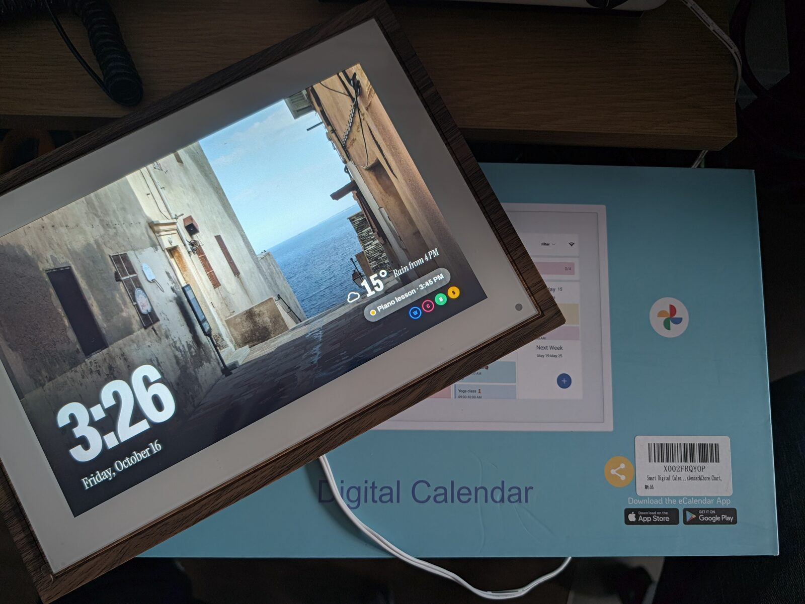

# C-2 10.1" digital calendar (joyhong, Allwinner A133, Android 10)



A record of **one unit**, bought from Amazon UK (listing not recorded), tested on 2026-10-16 from a Linux host
(CachyOS) over a USB-A to USB-C cable.
Frames sold under the same name can use different boards and firmware. Check every identity value below
before you copy anything from this page.

Closest relatives in this repo: the [LOOFII C-3](allwinner-a133-loofii-c3.md) (same A133 platform, same
partition names and order, same vendor calendar/FOTA apps) and the PF1506 (A133, AiMOR) in #104 and #118.
This is **not** a PF1007L: don't run the A33 or Rockchip routes on it.

## Identity

| | Value seen on this unit |
|---|---|
| Box | Brand "Shenzhen Zhixingsheng Electronics Co", 10.1" IPS screen |
| About screen | Model `C-2`, version 3.15.0 (the calendar app's version), firmware `C-2_A1339365080625_V05` |
| `ro.build.fingerprint` | `Allwinner/ceres_aw/ceres-aw:10/QP1A.191105.004/eng.JOY1.20241029.195308:user/test-keys` |
| Vendor fingerprint | `Allwinner/ceres_aw/ceres-aw:10/QP1A.191105.004/joy08061454:eng/test-keys` |
| Manufacturer / model props | `joyhong` / `C-2`, device `ceres-aw`, platform `ceres`, hardware `sun50iw10p1` |
| SoC | Allwinner **A133**. FEL reports `soc=00001855(A133)` |
| OS | Android 10 (SDK 29), security patch 2020-11-05, kernel 4.9.170, 32-bit userspace (`armeabi-v7a`) |
| RAM / storage | 2 GB / 32 GB eMMC (61,079,552 sectors, 31,272,730,624 bytes), 17 GPT partitions |
| Display | 10.1" IPS, 800×1280 panel, mounted rotated: Android runs it as 1280×800 landscape (`ROTATION_90`). Density 180 |
| Touch / sensors | `gslX680`, `mir3da` accelerometer, `pt3r850` light sensor, `MH248`, `bl_h18l232b` (presence driver, as on the C-3) |
| Wi-Fi | AIC8800 (`aic8800_fdrv`) |
| Ports | DC barrel jack + USB-C (device mode). Reset pinhole on the back, next to the USB-C port. Powered from the DC jack throughout; USB-only power not tried |
| USB IDs | Android with ADB `1f3a:1007` (product string `C-2`); BROM FEL `1f3a:efe8` |
| Boot | Blue "Welcome" animation, then the vendor calendar `com.fujia.calendar/.ui.DeviceMainActivity` |
| RTC | None. After a power cut the clock restarts at the build date (2025-08-06) until network time |

Firmware hashes from this unit (whole partitions, safe to compare):

| Partition | Start sector | Sectors | SHA-256 |
|---|---|---|---|
| `boot` (p3) | 247,568 | 131,072 | `203d8873b39106a8deee2ef3b5093b7bc2aa93ca4b9866001b1d979f26e1a663` |
| `recovery` (p6) | 4,605,712 | 65,536 | `dea757d8db23368c5c8cf02aef56c0655d751c9c4c1eadeb97e2171060ee9b4e` |
| `dtbo` (p15) | 6,440,720 | 4,096 | `1fb1855a70a5abc07a84c6c4e1d75414b51b541aa5340999d8b5c49dd8f256c4` |

`super` (p4) is 2 GiB at sector 378,640, as on the C-3. `UDISK` (p17, `/data`) runs to the end of the disk.
Note that `/proc/partitions` counts 1 KiB blocks: read sizes from `/sys/block/mmcblk0/size` (512-byte sectors).

## Access out of the box

- **Root ADB over USB with no prompt:** `persist.sys.usb.config=adb`, `ro.adb.secure=0`, `ro.debuggable=1`,
  `ro.secure=0`, SELinux permissive. `adb shell id` returns `uid=0(root)` on a fresh computer.
- `/system/xbin/su` is setuid and executable by any app (`-rwsrwsrwx`): **any app on the frame can get root.**
- **Root ADB over Wi-Fi too:** adbd listens on TCP 5555 on all interfaces, no key check. See
  [Network ADB](#network-adb-is-switched-on-in-two-places).
- The platform is signed with the **public AOSP test keys** (checked against
  `build/target/product/security` in AOSP): `framework-res.apk` uses the AOSP `platform` key (SHA-256
  `C8:A2:E9:BC…`), the WebView uses `testkey` (`A4:0D:A8:0A…`).

Treat the stock image as having no security. Keep it off untrusted networks.

## Backup (done first)

Over root ADB, no loader needed. The whole eMMC was streamed straight into gzip on the host, so the raw 31 GB
never touched the disk:

```sh
adb -d exec-out "dd if=/dev/block/mmcblk0 bs=4194304 2>/dev/null" | <hash + count> | gzip -3 > emmc-full.img.gz
```

Checked: exact byte count (31,272,730,624), no `0xCC` filler, `gzip -t` plus a decompressed re-hash equal to
the stream hash, and an independent on-device `sha256sum` of every partition, of the 36 MiB before p1 and of
the backup GPT. 15 of 17 partitions matched; `metadata` and `UDISK` differed because Android was writing to
them (not an atomic snapshot). Both 4 MiB hardware boot areas (`mmcblk0boot0/1`, identical to each other) were
saved separately. About 9 MB/s; 1.67 GB compressed on a freshly reset unit. Restore was not tested.

## Recovery routes (tested on this unit)

1. **USB ADB** (root, as shipped).
2. **FEL** via the pinhole: unplug DC power **and** USB, hold the pinhole, plug in DC then USB, release after
   3–5 s. The screen stays black, `lsusb` shows `1f3a:efe8`, and `sunxi-fel version` (sunxi-tools at
   `d7bbd172`, which supports the A133) prints `soc=00001855(A133)`. `sunxi-fel` needed `sudo` on Linux.
   Nothing was loaded over FEL; this only proves the route exists.
3. Not tried: U-Boot fastboot (`adb reboot bootloader`) and stock recovery. The C-3's notes cover both.

## The vendor FOTA boot hook (read this before disabling anything)

**Do not `pm disable` the whole `com.waophoto.fota` package.** On this firmware the vendor changed Android
itself so that the first activity started after each boot launches the updater:

- `services.jar`, `SystemServer.run()`: `SystemProperties.set("persist.sys.start_ac", "0")` at every boot.
- `framework.jar`, `Activity.onCreate()`: if `persist.sys.start_ac` is `<= 0`, start
  `com.waophoto.fota/.MainActivity`, then set the property to `1`.

(Read with jadx from the unit's own `framework.jar` and `services.jar`.) With the package disabled, that
`startActivity` throws `ActivityNotFoundException` before the property is set, so **every** activity crashes:
the kiosk, Settings' `FallbackHome`, SystemUI and the Home chooser. The screen stays black, the log fills with
`FATAL EXCEPTION` (600+ in a minute), and Android clears the Home preference of the crashing Home app. A running
session is not affected, so the failure only shows at the next boot. Root USB ADB kept working, and
`pm enable com.waophoto.fota` fixed it at once.

What works instead: FOTA's `MainActivity` only starts `MessageService` and finishes. `MessageService` is the
updater (plain HTTP to `fota.waophoto.com`; the APK also contains an ADB client and `su` command execution).
Disabling only that component keeps the hook happy and stops the updater:

```sh
adb shell pm disable com.waophoto.fota/.MessageService
# undo: adb shell pm enable com.waophoto.fota/.MessageService
```

After a cold boot: `persist.sys.start_ac=1`, no crashes from the hook, no FOTA service or connections. An idle
`com.waophoto.fota` process remains (started by the hook).

A string scan of `framework.jar` and `services.jar` found no other vendor package hard-coded this way (only
Allwinner SDK names: `com.softwinner.TvdVideo`, `TvdFileManager`, `awbms.Awbms`, `agingdragonbox`). The vendor
Settings also tries to start `com.waophoto.smartframe` (the home app of another brand; not installed here)
and logs the error harmlessly.

## The calendar app resets the display density

`com.fujia.calendar` (3.5.2 on `/system`, OTA-updated to 3.15.0 in `/data` on this unit) contains a
`SystemDisplayDensityController` that runs `wm density reset` (or its own value) when it starts. It starts at
every boot even when it isn't the Home app, so `wm density 160` was lost on each reboot. It also turns Wi-Fi on
at every boot (`setWifiEnabled` from `com.fujia.calendar`), and opened TLS connections to Google and an AWS
us-east address as soon as the frame was online.

After the kiosk was the Home app and had survived a cold boot, `pm disable-user --user 0 com.fujia.calendar`
was safe on this unit (nothing in the framework, Settings or other vendor apps references it; it is not a
device admin, accessibility service or notification listener), and `wm density 160` then persisted.

## Network ADB is switched on in two places

Port 5555 is opened by **both**:

1. `/vendor/etc/init/hw/init.device.rc` line 34: `setprop service.adb.tcp.port 5555`
2. `/system/etc/prop.default` line 58: `service.adb.tcp.port=5555`

Removing only the first left 5555 open. The unit already had an `adb remount` overlay from the factory
(`/mnt/scratch` on a `scratch` logical partition in `super`; its only content was
`/system/fullja_license/license.properties`), so both files were replaced with overlay copies that drop just
that line, keeping owner, mode and SELinux label:

```sh
adb shell mount -o remount,rw /vendor   # and /system for prop.default
# copy the edited file over the original path, then chown/chmod/chcon to match, then remount ro
```

After a cold boot `service.adb.tcp.port` was empty, nothing listened on 5555, and USB ADB still worked as root.
Undo: delete the copy under `/mnt/scratch/overlay/{vendor,system}/upper/...` and reboot. Anything that wipes the
scratch overlay (reflashing `super`, `adb enable-verity`) also undoes it. `init` reported line numbers from the
overlay copy, so the overlay is in place before `init` parses `/vendor/etc/init`.

## TCP 14035: AOSP's test sound-trigger HAL

The audio HAL process listens on `0.0.0.0:14035`. The socket belongs to
`/vendor/lib/hw/sound_trigger.primary.ceres.so`, which is AOSP's "Default sound trigger HAL" from
`hardware/libhardware/modules/soundtrigger`: a test stub that accepts text commands (`trig`, `update`, `close`)
to fake keyword triggers (going by the AOSP source and the library's strings; its code was not disassembled). It was blocked from the network with a boot action
added to the overlay copy of `init.device.rc`:

```
on property:sys.boot_completed=1
    exec u:r:su:s0 root root -- /system/bin/iptables -w -I INPUT -p tcp --dport 14035 ! -i lo -j DROP
```

The first version used `exec - root root --`, and `init` refused it: *"Could not start exec service … no
domain transition from u:r:init:s0"*. An explicit seclabel (`u:r:su:s0`, which exists on this debuggable build)
fixed it. The rule then appeared twice in `iptables -S INPUT` after boot; the cause wasn't confirmed, and the
duplicate is harmless.

## Other vendor software

Disabled on this unit with `pm disable-user --user 0`, one cold boot after the batch, no problems seen:
`com.joyhong.test` (factory test, runs as system), `com.softwinner.dragonfire`, `com.softwinner.dragonaging`,
`com.softwinner.dragonaging.res`, `com.allwinner.batterytest`, `com.softwinner.fireplayer` (video player
woken by media-scan broadcasts).

**awlog** copies logcat and kmsg to `/data/media/awlog` from two init services (`awlog_logcatd`,
`awlog_kmsgd`); disabling `com.softwinner.awlogsettings` alone doesn't stop them. Their switches are
properties handled by `/system/etc/init/awlogd.rc`:

```sh
adb shell setprop persist.debug.logcat.enable false
adb shell setprop persist.debug.kernel_log.enable false
adb shell setprop persist.debug.logpersistd clear   # became false; it did not delete the old logs
```

Both services stopped and stayed stopped after reboot. This unit had 80 MB of old logs, the oldest from
December 2025; they were deleted by hand.

Kept: `com.softwinner.awmanager` (settings page for Allwinner's background manager; its code only passes
whitelists and a limit to the `background` service, no network or shell code), `com.softwinner.settingssetup`,
`com.allwinnertech.packageoverride` and the theme overlays.

## WebView and the kiosk

The stock WebView is **74.0.3729.186** (`/product/app/webview`), too old for the repo's dashboard. Because the
WebView is signed with the AOSP `testkey`, the C-3's route worked unchanged:

- LineageOS `android_external_chromium-webview_prebuilt_arm` at commit
  `170e8996e41ef542769b5479297ab91072b487e2` ("Update Chromium Webview arm to 155.0.8059.39"). `webview.apk` is a
  Git LFS object: SHA-256 `e744cd81ea83cfa6bda3da471ce58a5d9eac5d32260ad0ef98b8c9f49348f20e`, 97,638,829 bytes,
  fetched through the LFS server in the repo's `.lfsconfig`.
- Re-signed with AOSP `testkey.pk8` / `testkey.x509.pem` using `apksigner` (build-tools 34), then
  `adb install -r`. `dumpsys webviewupdate` then reported 155.0.8059.39 as the current provider.
- Undo: `adb shell pm uninstall-system-updates com.android.webview`.

On 155, `oklch()`, `color-mix()`, `:has()`, CSS nesting, flex `gap` and `aspect-ratio` all worked.

`dashboard/kiosk` (Home HQ 1.1) worked as shipped:

- `wm density 160` is needed for the 1280×800 layout. At 180 the page is about 1138×711 CSS px and the
  dashboard is cropped with a black band at the top and left. It only sticks once the calendar app is disabled
  (see above).
- `--ez home true`, then `cmd package set-home-activity com.wesbos.homehq/.Home`. The two-finger menu reached
  Android Settings → Apps by hand.
- The repo's demo on `*.workers.dev` loaded over HTTPS on stock certificates.

## What did not work / open

- Disabling the whole FOTA package (see above).
- `svc wifi disable` doesn't survive a reboot while the calendar app is enabled.
- Vendor crashes seen at most boots after these changes (stock boots weren't checked): Settings' `FallbackHome`
  fails on the FOTA hook in the first seconds of boot, probably because FOTA isn't available yet, and SystemUI
  sometimes has a one-off `NullPointerException`. Android recovers on its own.
- Restore from the backup, fastboot and recovery were not tested.
