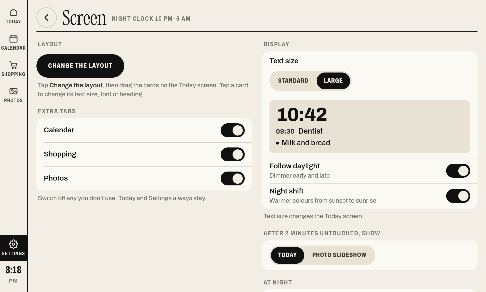

# Lexar Pexar PX-110 11" (Frameo, MediaTek MT8167, Android 11)


A record of **one unit**, worked on from macOS between 2026-11-13 and 2026-11-16 over a USB-A to
USB-C data cable. Observations are kept apart from guesses, and each claim says how it was checked.
Serials, addresses, Wi-Fi details and names are left out.

**Not the same as** other "Pexar" or "Lexar" frames. Match the firmware string and
`ro.product.device` before you use anything here.

## The short version

- **Root is one toggle away.** Frameo Settings → About → Beta Program → ADB access, plug in a data
  cable, `adb shell su 0 id` says `uid=0`.
- **Every lock on this frame opens with a public key.** Verified boot trusts the public AOSP test
  key. The MediaTek layer underneath trusts MediaTek's published sample keys. So you can change
  the system and the frame stays **locked and green**. No unlock, no orange screen.
- **We built a start-at-power-on hook** into a re-signed `product` image. It runs a script from
  `/data` as root at every boot. Everything else lives in `/data` and updates without a flash.
- **WebView 106** is laid over the stock WebView 83 at boot. No resize, no flash.
- **There is a way back from almost anything.** The chip's loader shows up on USB for 2–3 seconds
  at every power-on. No button, no test point, no key. mtkclient can read and write partitions
  through it.
- **The frame repairs itself.** Our own recovery image checks five partitions against known-good
  copies and puts back whatever is wrong. A three-step ladder (restart, safe mode, stop and wait)
  catches an Android that will not come up.
- **Six failure drills, all recovered.** We damaged `vbmeta_system`, `product`, `logo` and `boot`
  on purpose. The frame fixed each one and was back, green, in about a minute.
- **Two traps cost us hours:** MediaTek DuraSpeed (white page) and Frameo deleting the Wi-Fi it
  saved. Both are below.
- **Stay on V2.06.** Nobody has checked whether V2.08 still trusts the test key.

**This is a record, not a procedure.** It gives no flash commands. A full backup came first, a
brick was accepted as the worst case, and every write was approved one at a time by the owner.

## For agents

Read the whole page before you propose anything, then follow the
[README rules](../README.md#rules-we-learned-the-hard-way). On this frame they come down to:

1. **Match identity first.** `ro.product.device` = `dpf1106_mk_32`, firmware
   `PF1106_V2.06_20250527`, verified-boot state `green`. Anything else: stop and report. Nothing
   here is known to hold on another firmware.
2. **Check the key before you trust the page.** Section 4 gives a read-only check. If the `vbmeta`
   public key is not the AOSP test key, none of the re-signing applies. Stop.
3. **Back up every partition before the first write** (all but `userdata` and `rpmb`), with hashes,
   and re-read a few to compare. Dumps hold the Wi-Fi password and identifiers: keep them private.
4. **Prove the loader port before you depend on it.** Read a partition through it and compare the
   hash with the same read over ADB. Then write one partition back with the same bytes it already
   holds and read it back. Only then is it your net.
5. **Never write** `preloader`, `lk`, `lk2`, `tee1`, `tee2`, `seccfg`, `frp`, `md_udc`, `nvram`,
   `nvdata`, `proinfo`, `persist` or `rpmb`. Nothing on this page needed them. Below them the only
   net is the chip's boot ROM mode, which is **untested** here.
6. **One write at a time, each with the owner's yes.** Check the image hash and the live partition
   before, stop Android's services, write, flush, read back, and only then restart.
7. **`product`, `vbmeta_system` and `vbmeta` are a family.** They only start as a matching set.
   Write all three, read all three back, then restart.
8. **Save Wi-Fi through Android's own Settings before you disable Frameo.** Disabling Frameo
   removes the networks it saved, and your network access goes with them.
9. **Keep it off the internet until the vendor updater is gone**, and never pair it with the Frameo
   app. A vendor update can close every door on this page.
10. **Do not key anything off the load average.** It idles near 6 on this kernel (section 11).
11. **Say what is proven and what is a guess.** Section 13 lists what nobody has tested.

What is and is not in this PR: the page describes tools we wrote (a recovery script, a `boot`
wrapper, image builders and checkers, a repair script). They are not included. They live in a
private repo and are tied to one unit's hashes. Ask in an issue if you want them tidied up for
this repo.

## 1. Identity

| Item | Seen on this unit |
| --- | --- |
| Sold as | Lexar Pexar PX-110, 11", 2000×1200 |
| `ro.product.device` | `dpf1106_mk_32` |
| Firmware | `PF1106_V2.06_20250527`. No update was offered to this unit |
| SoC | MediaTek MT8167, 32-bit userland (`armeabi-v7a`), kernel 4.14.186 |
| RAM / storage | 2 GB / eMMC, about 26 GB for data, 28 partitions, dynamic partitions in `super` |
| Android | 11 (SDK 30), `user/release-keys`, security patch 2022-08-01 |
| Display | 2000×1200, density 240. A web page sees about 1333×800 |
| Sensors | Accelerometer only. **No light sensor** |
| Buttons | A power button. No volume keys |
| USB IDs | `0e8d:2008` (Android with ADB), `0e8d:2000` (preloader, 2–3 s at power-on) |
| Bootloader | Locked, verified boot **green** |
| SELinux | Permissive |
| WebView | `com.android.webview` 83.0.4103.120, vendor-signed, the only accepted provider |
| Vendor apps | Frameo (`net.frameo.frame`, the Home app), `com.adups.fota` (updater), `com.DeviceTest`, `com.mediatek.engineermode` |

## 2. Root over USB

Frameo Settings → About → Beta Program → **ADB access**. With a USB-A to USB-C data cable,
`adb shell su 0 id` returns `uid=0` in the `su` context. `/system/xbin/su` is setuid and any app
can run it. Use `su 0 <command>`, not `su -c`.

`adb install` of a new app is refused ("is not allow to install"). While
`ro.vendor.custom_recover` is `1`, the vendor's package manager only installs or updates packages
that are already system apps. Two ways round it: a temporary `services.jar` patch (the community
`pexar-installer-script` route), or put your app in the system image so it already is a system
app. We did the second (section 5).

## 3. Back up first

With root, every partition except `userdata` and `rpmb` was read out over ADB, hashed and kept
off the frame. Everything later on this page was worked out against that backup before
it went near the frame. The backup holds identifiers and the saved Wi-Fi password. It stays
private.

## 4. The keys

**Observed.** The public key in `vbmeta`, and the copy built into the bootloader (`lk`), is the
public AOSP `testkey_rsa2048` (RSA-2048, SHA-1 `cdbb77177f731920bbe0a0f94f84d9038ae0617d`, modulus
begins `C65551DD`). AOSP publishes both halves in its AVB test data (`platform/external/avb`,
`test/data/testkey_rsa2048.pem`). Re-signing the stock `vbmeta` contents with it reproduces the
shipped signature byte for byte.

The layer under Android uses MediaTek's sample keys, which are also published. The maker replaced
none of them.

| Stage | Checked by | Key (modulus begins) | Public? | How we know |
| --- | --- | --- | --- | --- |
| Preloader | boot ROM | MediaTek default root key `9BB73477` | Yes | Signature verified against the backup. Whether the boot ROM enforces it is a guess: the chip reports secure boot off |
| `lk`, `lk2`, `tee1`, `tee2` | preloader | Root key `9BB73477`, then an image key `B56FB4CA` (a MediaTek default) | Yes | All nine signed pieces verify against the backup. Enforcement unknown. Never written |
| `logo` | `lk` | Same two-certificate scheme | Yes | A logo we signed was accepted on the frame |
| `vbmeta` | `lk` | AOSP test key `C65551DD` | Yes | Enforced. Our re-signed `vbmeta` boots green |
| `dtbo` | hash inside `vbmeta` | none of its own | n/a | Structure read from the backup |
| `vbmeta_system` | chain entry in `vbmeta` | `CF41A118` (a MediaTek default) | Yes | We did not need it: we re-signed with the test key and repointed the chain entry |
| `vbmeta_vendor` | chain entry in `vbmeta` | `BE38089E` (a MediaTek default) | Yes | Untouched on the frame |
| `boot` | chain entry in `vbmeta` | `C9E582E2` (a MediaTek default) | Yes | Our `boot` signed with it runs on the frame, `vbmeta` unchanged |
| `recovery` | key built into `lk` | `B600B1CE` (a MediaTek default) | Yes | Our recovery signed with it runs on the frame |
| System apps, OTA packages | Android | the maker's own four keys | **No** | Certificates read from `system`. Not needed |
| Lock state (`seccfg`) | preloader, `lk` | a key inside the chip | **No** | Not needed. Every change was made locked |

**What that means.** Anyone who can write the flash can run their own system images on this
frame with the bootloader locked and the boot state green. Writing the flash needs a root shell
(the ADB toggle and a cable) or the loader port (a cable and a power cycle).

**What it does not mean.** It is not a way in from the network. We found none and did not look
for one.

**What stays closed.** The maker's app-signing keys. Our app cannot be signed as `platform`. It
did not need to be: it sits in our `product` image as a system app, and the root script does the
rest.

**Read-only check for your unit** (reads one block, sends nothing anywhere):

```sh
adb shell getprop ro.build.display.id
adb shell getprop ro.boot.verifiedbootstate
adb exec-out su 0 dd if=/dev/block/by-name/vbmeta bs=4096 count=1 > vbmeta.img
python3 avbtool.py info_image --image vbmeta.img | grep -i -E "algorithm|public key"
```

`avbtool.py` is AOSP's. The test key reads
`Public key (sha1): cdbb77177f731920bbe0a0f94f84d9038ae0617d`. If you report a result, give the
firmware string, the boot state and whether the digest matches. Do not post the `vbmeta` file.

## 5. What we changed on the flash

Six partitions, each write read back before the restart. After every change: locked, green.

| Partition | What it holds now | Why |
| --- | --- | --- |
| `product` (inside `super`) | Stock plus one init file and our kiosk app. The updater `com.adups.fota` removed | The start-at-power-on hook |
| `vbmeta_system` | Re-signed with the test key, new `product` hash tree | Makes the new `product` verify |
| `vbmeta` | Chain entry for `vbmeta_system` repointed to the test key | Same |
| `recovery` | Stock recovery plus our repair script, signed with the published recovery key | Self-repair (section 9) |
| `logo` | Our first picture, signed under the MediaTek root key | Cosmetic |
| `boot` | Stock kernel, device tree and command line, byte for byte. A small wrapper runs before the stock `init` | Arms the recovery note before anything else can fail (section 9) |

`vbmeta_vendor`, `lk`, the preloader and everything else are factory.

**The hook.** Every init script on this firmware sits on a read-only partition. Our `product`
adds `/product/etc/init/<name>.rc` with three things:

- a root `oneshot` service (`seclabel u:r:su:s0`) that runs a script from `/data` when
  `sys.boot_completed=1`;
- an `on post-fs-data` step that runs an earlier script from `/data` (firewall before Wi-Fi);
- an `on post-fs-data` bind mount of a boot animation from `/data` over the stock one, so the
  animation can change without a flash. No file there: the stock animation plays.

`init` ends the service's children when the script exits, so the script ends in a sleep loop.
About 9 MB stayed free on `product`. The `product` extent in `super` was not moved or resized.

**Builders and checkers.** The `product`, `recovery`, `logo` and `boot` builds each have their
own checker, run before any flash. For `boot` the checker shares no code with the builder, fails
on a flipped bit and on a correctly signed image with the wrong contents, and a rebuild gives the
same bytes. Tests run on the Mac against stand-ins: 173 for the recovery script (with a model of
the bootloader), 52 for the `boot` wrapper, 91 for the repair script.

## 6. What runs from `/data`

No flash needed for any of this. A factory reset wipes it.

- A Linux folder with Python and the dashboard's server, plus a watchdog that keeps the kiosk up.
- The kiosk app as Home. Frameo disabled.
- WebView 106 (section 7), the app firewall (section 8), DuraSpeed off (section 11).
- ADB over USB, and over a private tailnet. Port 5555 is dropped on Wi-Fi.
- Brightness that follows local sunrise and sunset, with a warm tint after dark. This stands in
  for the missing light sensor.



## 7. WebView 106

The vendor WebView 83 cannot be updated: it is vendor-signed and the only accepted provider.
WebView 106 does not fit in `product` without resizing it inside `super`. We did not resize.

What works: at boot, the script bind-mounts a folder holding a WebView 106 APK and its unpacked
`lib/arm/*.so` over `/product/app/webview`, then restarts the framework once (`stop; start`).
`dumpsys webviewupdate` then reports 106.0.5249.126. A restart undoes it, so it runs every boot.
The cost is about ten seconds of black screen during start-up. We do not redistribute the APK.

## 8. App firewall

The first thing the boot script does. `iptables` and `ip6tables`, re-checked every 10 seconds:

- allowed out: loopback, the kiosk app's uid, root, the dashboard server;
- rejected: every other app uid from 10000 to 19999, Frameo included;
- dropped in: ADB's port 5555 on `wlan0`.

It fails closed: if the firewall script is missing, nothing else is started. About 180 Frameo packets were
refused per boot before Frameo was disabled. This is a courtesy layer. Root can undo it. Block
the frame at the router as well: see [Frame security](security.md).

## 9. The safety net

Three layers. The deepest one needs nothing on the frame to be working.

### Layer 1: the loader port

At every power-on the MediaTek preloader appears on USB as `0e8d:2000` for 2–3 seconds. No button
is pressed. The target reports config `0x0`: no secure boot, no tool authentication. So
[mtkclient](https://github.com/bkerler/mtkclient) connects with no key and can read and write
partitions, with Android dead or alive.

**Observed on the frame:** reads of every partition we care about, matching the same reads over
ADB. Writes of `logo`, `recovery`, `para` and `boot`, each read back correct. A full `boot` write
(32 MiB) took about 7 minutes in serial mode.

Three things we had to work out on macOS:

- Serial mode only (`--serialport DETECT`). The reply timeouts needed raising for macOS serial.
- If you miss the 2–3 second window the frame just boots. Nothing was written. Restart and try
  again.
- **mtkclient's `reset` leaves this frame stuck.** It asks the loader to shut down and wait for
  the cable to be pulled. The frame never powers off: dark screen,
  still on USB as the preloader, because the cable keeps it powered. The fix is to restart through the chip's watchdog instead: write
  `0x22000014` to `0x10007000`, then `0x1209` to `0x10007014`. Two register writes, nothing on
  flash. Three restarts in a row with no unplugging. Without the fix, unplug and replug.

### Layer 2: our recovery

The bootloader reads a note in the `para` partition before it verifies anything. If the note says
`boot-recovery`, it starts recovery instead of Android. That one fact carries the whole design: a
frame whose Android images fail verification can still reach recovery.

Our recovery is the stock one plus a script. On our own note it:

1. Checks five regions against a list kept in `cache`: `product`, `vbmeta_system`, `vbmeta`,
   `logo`, `boot`.
2. Restores any that are wrong from a gzip copy beside the list. The copy is checked three ways
   before it is written (file hash, unpacked hash, exact length) and the write is read back.
3. Climbs a ladder, counted across restarts: first time restart, second time restart into safe
   mode, third time stay in recovery with ADB up.

Rules it never breaks:

- It only writes those five regions. Their offsets and lengths are fixed in the script. The list
  cannot name a device or an offset.
- It acts only on our own note. A pending factory reset or update is left to the stock program.
- It never restarts while a listed partition is still wrong. That would be a red screen for good.
- A restore cut off by a power loss is resumed at the next power-on, three tries at most.
- A malformed or half-written list is refused whole.

One full known-good set is about 73 MB compressed and fits in `cache` (about 108 MB free). It
holds one `product`, not a choice of two.

### Layer 3: Android arms and disarms

- **Armed at every start.** A small wrapper is the first program in our `boot` image. If the note
  is empty it writes ours, reads it back, then starts the stock `init` unchanged. It never
  touches a note that is not empty and cannot hold a start up for more than 5 seconds.
- **All clear after 5 healthy minutes.** Once the kiosk has been confirmed up and the frame has
  run for 5 minutes, the boot script clears the ladder counter and then the note.
- **15-minute deadline.** An Android that never reaches the all clear restarts itself, and that
  restart lands in recovery.
- **Safe mode.** Firewall, ADB and the tailnet only. No kiosk, no server. Safe mode set by the
  ladder ends itself after 30 minutes.
- **Android's own rescue party is off** (`persist.sys.disable_rescue`). It can leave a wipe note
  that waits for a key this frame does not have.

The wrapper also changes one word in the stock first-stage `init`: a failed first stage now
restarts to `recovery` instead of `bootloader`. Ten bytes. The checker confirms nothing else in
that program differs.

**The side effect to know about.** Restart the frame by hand within 5 minutes of a start and it
goes through recovery first (about a minute). Do it twice and safe mode comes on. Both end by
themselves.

### Guarded flash

How a new image goes on now. Tell the list to expect the new image while its stored copy is still
the old one. Arm the note. Write, read back, restart. The bootloader goes to recovery first.
Recovery finds either exactly the new image (leaves it) or anything else (puts the old one back).
Then Android starts. A guarded flash cannot catch an image that was written correctly and still
does not start. For `boot`, the net for that is the loader port.

### Drills on the frame (2026-11-16)

| Damage done on purpose | Result |
| --- | --- |
| 8 bytes changed in the signed part of `vbmeta_system` | Bootloader honoured the note before verifying. Restored. Green in 52 s |
| First 1 MB of `product` zeroed | 110 MB restored in about 10 s. Green in about 70 s |
| Logo picture data changed, certificate intact | Restored in 52 s with the note. **Without the note, Android started green with the bad logo** |
| 8 bytes changed in `boot` | 32 MiB restored in about 1 s. Green in 55 s |
| Watchdog removed so the kiosk never reports healthy | Deadline restart at 900 s, one rung, back and all clear |
| Restart by hand before the all clear, twice | Second rung set safe mode. ADB and the tailnet stayed up |
| Stock `boot` written back through the loader port | Read back correct. Proves the way back for `boot` |

The logo row is worth a second look: `lk` does not enforce the logo's data hash. A bad logo is
cosmetic on this unit. A damaged logo signature block was not tried.

## 10. First picture and boot animation

- **Animation:** a file in `/data`, bind-mounted at boot. Changing it needs no flash.
- **Logo** (the picture before Android): picture 0 in the `logo` partition, 2000×1200. We
  rebuild the partition from a picture and sign it with the MediaTek root key and a published
  MediaTek image key.
- With Frameo disabled, the boot animation can stay on top of your Home app until
  `sys.bootanim.exit` is set.

## 11. Traps

- **DuraSpeed white page.** After any force-stop of the kiosk, MediaTek's DuraSpeed put it on a
  suppress list and the WebView renderer never started. It looked like a hang. Fix: set
  `persist.vendor.duraspeed.support` and `persist.vendor.duraspeed.app.on` to `0` early in the
  boot script. Check with `dumpsys duraspeed suppress_list`. Guess: other MediaTek frames do the same.
- **Disabling Frameo deletes the Wi-Fi it saved.** Save the network through Android's Settings
  first.
- **Frameo powers the frame off on "battery".** A USB data host reads as "USB powered" and
  Frameo's `APowerOffNotice` shuts down. Disabling Frameo ends it.
- **Load average idles near 6.** MediaTek kernel threads sit in D state. It means nothing.
- **`mCurrentFocus` on Android 11** is only in the whole `dumpsys window` output. A watchdog
  that reads a narrower dump will not find it.
- **Stock recovery waits for a key the frame does not have.** It restarts by itself after about
  two minutes with USB unplugged.
- **A factory reset** wipes `/data` and `cache` and brings Frameo back. The flashed images and
  their hooks stay. The recovery's stored copies are gone and must be stored again.

## 12. Firmware: stay on V2.06

- This unit was offered no update, stock or freshly reset. The vendor updater answered with a
  status and no file.
- V2.08 exists. One public write-up reports WebView 106 on it and that writes to `/system` do
  not survive a reboot. Its installer worked there, which suggests root over USB still does.
  **Not verified by us.**
- **Unknown:** whether V2.08 still trusts the test key. If you have V2.08 and ADB root, the
  check in section 4 answers it.
- Everything here leans on three things staying as they are: the shipped `su`, the test key, and
  the open loader port. An update can change any of them.

## 13. Not tested

- A real first-stage failure with the `boot` wrapper in place. On hold: `lk` has its own
  dm-verity handling that may put up a warning screen first.
- The chip's boot ROM mode (`0e8d:0003`), the fallback if the preloader itself is lost. Standard
  MediaTek behaviour says an empty preloader area drops the chip into it, and that mtkclient then
  needs a preloader file for the memory settings. Never seen on this unit.
- A power cut in the middle of a restore. The resume logic is tested on a model, not on the frame.
- A damaged logo signature block.
- Any other unit, any other firmware.
- Whether the preloader, `lk` and `tee` signatures are enforced. They must not be tested by
  writing.

## 14. Responsible note

The maker ships this frame with verified boot signed by the public AOSP test key, and with
MediaTek's published sample keys underneath. That removes the protection that stops someone with
write access to the flash from running their own system. Owners should know, because a
second-hand frame is only as trustworthy as whoever last held it, and because the same open door
that lets an owner fix their frame lets anyone with a cable do the same. We found no way in from
the network and did not test for one. We have not contacted the vendor. Treat the frame as an
untrusted appliance: isolate it at the router and give it nothing you would not hand a stranger.
See [Frame security](security.md).

## 15. Risks and limits

- Partitions the recovery never checks (`dtbo`, `tee1`, `tee2`, `lk`, `lk2`, `vbmeta_vendor`,
  preloader): a bad one means a red screen with no note. Only the loader port and the backup
  help. We never write them.
- `seccfg` is sealed with the chip's own key. The bootloader cannot be unlocked offline, and the
  frame has no volume keys for the bootloader's own unlock prompt. Nothing here needed an unlock.
- The kiosk is debug-signed. Later updates must use the same key.
- The image builds are tied to this firmware's `product` layout inside `super`. A different
  layout needs the offsets worked out again.
