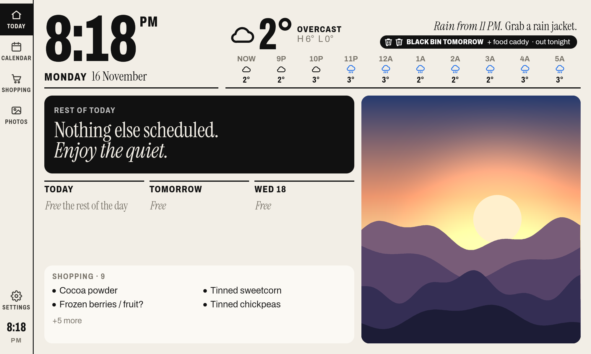

# Lexar Pexar PX-110 11" (Frameo, MediaTek MT8167, Android 11)



A record of **one unit**, worked on from macOS between 2026-11-13 and 2026-11-16 over a USB-A to
USB-C data cable. Observations are kept apart from guesses, and each claim says how it was checked.
Serials, addresses, Wi-Fi details and names are left out.

**Not the same as** other "Pexar" or "Lexar" frames. Match the firmware string and
`ro.product.device` before you use anything here.

## The short version

- **Root is one toggle away.** Frameo Settings → About → Beta Program → ADB access, plug in a data
  cable, `adb shell su 0 id` says `uid=0`.
- **Every lock on this frame opens with a public key.** Verified boot trusts the public AOSP test
  key. The MediaTek layer underneath trusts MediaTek's published sample keys. So you can change
  the system and the frame stays **locked and green**. No unlock, no orange screen.
- **We built a start-at-power-on hook** into a re-signed `product` image. It runs a script from
  `/data` as root at every boot. Everything else lives in `/data` and updates without a flash.
- **WebView 106** is laid over the stock WebView 83 at boot. No resize, no flash.
- **There is a way back from almost anything.** The chip's loader shows up on USB for 2–3 seconds
  at every power-on. No button, no test point, no key. mtkclient can read and write partitions
  through it.
- **The frame repairs itself.** Our own recovery image checks five partitions against known-good
  copies and puts back whatever is wrong. A three-step ladder (restart, safe mode, stop and wait)
  catches an Android that will not come up.
- **Six failure drills, all recovered.** We damaged `vbmeta_system`, `product`, `logo` and `boot`
  on purpose. The frame fixed each one and was back, green, in about a minute.
- **Two traps cost us hours:** MediaTek DuraSpeed (white page) and Frameo deleting the Wi-Fi it
  saved. Both are below.
- **Stay on V2.06.** Nobody has checked whether V2.08 still trusts the test key.
- **You can repeat it.** Section 16 has the steps. The tools are in
  [scripts/lexar-px110](../scripts/lexar-px110/README.md). This firmware only.

**Sections 1 to 15 are a record of one unit.** Section 16 gives the steps, the commands and the
tools to repeat it on the same firmware, each step with its check and its way back. A full backup
came first, a brick was accepted as the worst case, and every write was approved one at a time by
the owner. Nothing here is safe in every case.

## For agents

Read the whole page before you propose anything, then follow the
[README rules](../README.md#rules-we-learned-the-hard-way). On this frame they come down to:

1. **Match identity first.** `ro.product.device` = `dpf1106_mk_32`, firmware
   `PF1106_V2.06_20250527`, verified-boot state `green`. Anything else: stop and report. Nothing
   here is known to hold on another firmware.
2. **Check the key before you trust the page.** Section 4 gives a read-only check. If the `vbmeta`
   public key is not the AOSP test key, none of the re-signing applies. Stop.
3. **Back up every partition before the first write** (all but `userdata` and `rpmb`), with hashes,
   and re-read a few to compare. Dumps hold the Wi-Fi password and identifiers: keep them private.
4. **Prove the loader port before you depend on it.** Read a partition through it and compare the
   hash with the same read over ADB. Then write one partition back with the same bytes it already
   holds and read it back. Only then is it your net.
5. **Never write** `preloader`, `lk`, `lk2`, `tee1`, `tee2`, `seccfg`, `frp`, `md_udc`, `nvram`,
   `nvdata`, `proinfo`, `persist` or `rpmb`. Nothing on this page needed them. Below them the only
   net is the chip's boot ROM mode, which is **untested** here.
6. **One write at a time, each with the owner's yes.** Check the image hash and the live partition
   before, stop Android's services, write, flush, read back, and only then restart.
7. **`product`, `vbmeta_system` and `vbmeta` are a family.** They only start as a matching set.
   Write all three, read all three back, then restart.
8. **Save Wi-Fi through Android's own Settings before you disable Frameo.** Disabling Frameo
   removes the networks it saved, and your network access goes with them.
9. **Keep it off the internet until the vendor updater is gone**, and never pair it with the Frameo
   app. A vendor update can close every door on this page.
10. **Do not key anything off the load average.** It idles near 6 on this kernel (section 11).
11. **Say what is proven and what is a guess.** Section 13 lists what nobody has tested.

What is and is not in this PR: the tools are in
[scripts/lexar-px110](../scripts/lexar-px110/README.md) (the recovery script, the `boot` wrapper,
image builders and checkers, the repair script, their tests, our mtkclient patch). They are tied
to firmware `PF1106_V2.06_20250527` and refuse a backup with other hashes or another `product`
layout. Not included: keys (a script fetches them and checks each hash), any backup or firmware
file, the kiosk APK, the WebView APK, a logo picture, and the scripts that run from `/data`
(section 16, steps 6 and 8, gives their commands).

## 1. Identity

| Item | Seen on this unit |
| --- | --- |
| Sold as | Lexar Pexar PX-110, 11", 2000×1200 |
| `ro.product.device` | `dpf1106_mk_32` |
| Firmware | `PF1106_V2.06_20250527`. No update was offered to this unit |
| SoC | MediaTek MT8167, 32-bit userland (`armeabi-v7a`), kernel 4.14.186 |
| RAM / storage | 2 GB / eMMC, about 26 GB for data, 28 partitions, dynamic partitions in `super` |
| Android | 11 (SDK 30), `user/release-keys`, security patch 2022-08-01 |
| Display | 2000×1200, density 240. A web page sees about 1333×800 |
| Sensors | Accelerometer only. **No light sensor** |
| Buttons | A power button. No volume keys |
| USB IDs | `0e8d:2008` (Android with ADB), `0e8d:2000` (preloader, 2–3 s at power-on) |
| Bootloader | Locked, verified boot **green** |
| SELinux | Permissive |
| WebView | `com.android.webview` 83.0.4103.120, vendor-signed, the only accepted provider |
| Vendor apps | Frameo (`net.frameo.frame`, the Home app), `com.adups.fota` (updater), `com.DeviceTest`, `com.mediatek.engineermode` |

## 2. Root over USB

Frameo Settings → About → Beta Program → **ADB access**. With a USB-A to USB-C data cable,
`adb shell su 0 id` returns `uid=0` in the `su` context. `/system/xbin/su` is setuid and any app
can run it. Use `su 0 <command>`, not `su -c`.

`adb install` of a new app is refused ("is not allow to install"). While
`ro.vendor.custom_recover` is `1`, the vendor's package manager only installs or updates packages
that are already system apps. Two ways round it: a temporary `services.jar` patch (the community
`pexar-installer-script` route), or put your app in the system image so it already is a system
app. We did the second (section 5).

## 3. Back up first

With root, every partition except `userdata` and `rpmb` was read out over ADB, hashed and kept
off the frame. Everything later on this page was worked out against that backup before
it went near the frame. The backup holds identifiers and the saved Wi-Fi password. It stays
private.

## 4. The keys

**Observed.** The public key in `vbmeta`, and the copy built into the bootloader (`lk`), is the
public AOSP `testkey_rsa2048` (RSA-2048, SHA-1 `cdbb77177f731920bbe0a0f94f84d9038ae0617d`, modulus
begins `C65551DD`). AOSP publishes both halves in its AVB test data (`platform/external/avb`,
`test/data/testkey_rsa2048.pem`). Re-signing the stock `vbmeta` contents with it reproduces the
shipped signature byte for byte.

The layer under Android uses MediaTek's sample keys, which are also published. The maker replaced
none of them.

| Stage | Checked by | Key (modulus begins) | Public? | How we know |
| --- | --- | --- | --- | --- |
| Preloader | boot ROM | MediaTek default root key `9BB73477` | Yes | Signature verified against the backup. Whether the boot ROM enforces it is a guess: the chip reports secure boot off |
| `lk`, `lk2`, `tee1`, `tee2` | preloader | Root key `9BB73477`, then an image key `B56FB4CA` (a MediaTek default) | Yes | All nine signed pieces verify against the backup. Enforcement unknown. Never written |
| `logo` | `lk` | Same two-certificate scheme | Yes | A logo we signed was accepted on the frame |
| `vbmeta` | `lk` | AOSP test key `C65551DD` | Yes | Enforced. Our re-signed `vbmeta` boots green |
| `dtbo` | hash inside `vbmeta` | none of its own | n/a | Structure read from the backup |
| `vbmeta_system` | chain entry in `vbmeta` | `CF41A118` (a MediaTek default) | Yes | We did not need it: we re-signed with the test key and repointed the chain entry |
| `vbmeta_vendor` | chain entry in `vbmeta` | `BE38089E` (a MediaTek default) | Yes | Untouched on the frame |
| `boot` | chain entry in `vbmeta` | `C9E582E2` (a MediaTek default) | Yes | Our `boot` signed with it runs on the frame, `vbmeta` unchanged |
| `recovery` | key built into `lk` | `B600B1CE` (a MediaTek default) | Yes | Our recovery signed with it runs on the frame |
| System apps, OTA packages | Android | the maker's own four keys | **No** | Certificates read from `system`. Not needed |
| Lock state (`seccfg`) | preloader, `lk` | a key inside the chip | **No** | Not needed. Every change was made locked |

**Where each key is published.** These are public GitHub copies of MediaTek's sample keys, not an
official source. `fetch-keys.sh` downloads the first seven from these exact commits and refuses a
file whose SHA-256 differs. The hash lets you check a copy from anywhere else.

| Key (modulus begins) | File | Published at | SHA-256 of the file |
| --- | --- | --- | --- |
| AOSP test key `C65551DD` | `common/oem_prvk.pem`, the same key as AOSP's `testkey_rsa2048.pem` | `OpenWatchProject/android_device_mediatek` at `123c88624325d417ceb072f86b40d168fa478a7e` | `f1d5765a2bdfb92fb08aee021107c7ac1a7a3f590dafd853771c85375ef0fbd7` |
| `boot` key `C9E582E2` | `common/boot_prvk.pem` | same repo and commit | `4db337d4ce0368f6223491ee19c89fc3e1a240693c8bb1d5d9920fdb7fdb0b05` |
| `recovery` key `B600B1CE` | `common/recovery_prvk.pem` | same repo and commit | `1442098aea914fa8a312ca92e11bb574e8e802e92279eb422fc8d8aea56c4508` |
| `vbmeta_system` key `CF41A118` | `common/system_prvk.pem` | same repo and commit | `886a0068187dd48e9c98aba6437eddf6476782e94d463567cf69a88a1fc1f3de` |
| `vbmeta_vendor` key `BE38089E` | `common/vendor_prvk.pem` | same repo and commit | `ec626c0ddea749079f4297bfde33ad777b202d5ecf455b4c7808ecb934da1c24` |
| MediaTek root key `9BB73477` | `keys/root_prvk.pem` | `TheGammaSqueeze/mtk-lk-tools` at `1eff1b6051fd0312a43faa73f3e955a254de622d` | `1a29171880f54e99cd29e32ed643fe8031480cef7146fba931b76b6dfab4ec4e` |
| Image key we sign `logo` with (not on the frame) | `keys/img_prvk.pem` | same repo and commit | `757e727ea1a52f6b66d101a3b0b003600df9ea0f4b9ef06646ce1958a21692a2` |
| Stock image key `B56FB4CA` (not fetched, not needed) | `mcu/pcore/tools/key_info.ini`, as hex numbers, not a key file | `junkyard-2327/TK_MD_BASIC_MOLY.LR12A.R3.MP.V110.6` at `04ebd402fe9472e0c2e3da5a296c11819307b929` | `ae6f7b10e702f25f5052ffdffcf60d5b82acd0fc027aa0933a3c137e476a813b` |

**What that means.** Anyone who can write the flash can run their own system images on this
frame with the bootloader locked and the boot state green. Writing the flash needs a root shell
(the ADB toggle and a cable) or the loader port (a cable and a power cycle).

**What it does not mean.** It is not a way in from the network. We found none and did not look
for one.

**What stays closed.** The maker's app-signing keys. Our app cannot be signed as `platform`. It
did not need to be: it sits in our `product` image as a system app, and the root script does the
rest.

**Read-only check for your unit** (reads one block, sends nothing anywhere):

```sh
adb shell getprop ro.build.display.id
adb shell getprop ro.boot.verifiedbootstate
adb exec-out "su 0 sh -c 'dd if=/dev/block/by-name/vbmeta bs=4096 count=1 2>/dev/null'" > vbmeta.img
python3 avbtool.py info_image --image vbmeta.img | grep -i -E "algorithm|public key"
```

`avbtool.py` is AOSP's. The test key reads
`Public key (sha1): cdbb77177f731920bbe0a0f94f84d9038ae0617d`. If you report a result, give the
firmware string, the boot state and whether the digest matches. Do not post the `vbmeta` file.

## 5. What we changed on the flash

Six partitions, each write read back before the restart. After every change: locked, green.

| Partition | What it holds now | Why |
| --- | --- | --- |
| `product` (inside `super`) | Stock plus one init file and our kiosk app. The updater `com.adups.fota` removed | The start-at-power-on hook |
| `vbmeta_system` | Re-signed with the test key, new `product` hash tree | Makes the new `product` verify |
| `vbmeta` | Chain entry for `vbmeta_system` repointed to the test key | Same |
| `recovery` | Stock recovery plus our repair script, signed with the published recovery key | Self-repair (section 9) |
| `logo` | Our first picture, signed under the MediaTek root key | Cosmetic |
| `boot` | Stock kernel, device tree and command line, byte for byte. A small wrapper runs before the stock `init` | Arms the recovery note before anything else can fail (section 9) |

`vbmeta_vendor`, `lk`, the preloader and everything else are factory.

**The hook.** Every init script on this firmware sits on a read-only partition. Our `product`
adds `/product/etc/init/<name>.rc` with three things:

- a root `oneshot` service (`seclabel u:r:su:s0`) that runs a script from `/data` when
  `sys.boot_completed=1`;
- an `on post-fs-data` step that runs an earlier script from `/data` (firewall before Wi-Fi);
- an `on post-fs-data` bind mount of a boot animation from `/data` over the stock one, so the
  animation can change without a flash. No file there: the stock animation plays.

`init` ends the service's children when the script exits, so the script ends in a sleep loop.
About 9 MB stayed free on `product`. The `product` extent in `super` was not moved or resized.

**Builders and checkers.** The `product`, `recovery`, `logo` and `boot` builds each have their
own checker, run before any flash. For `boot` the checker shares no code with the builder, fails
on a flipped bit and on a correctly signed image with the wrong contents, and a rebuild gives the
same bytes. Tests run on the Mac against stand-ins: 173 for the recovery script (with a model of
the bootloader), 52 for the `boot` wrapper, 130 for the repair script, 27 that the tools refuse what they must, 30 for the write blocks in section 16.

## 6. What runs from `/data`

No flash needed for any of this. A factory reset wipes it.

- A Linux folder with Python and the dashboard's server, plus a watchdog that keeps the kiosk up.
- The kiosk app as Home. Frameo disabled.
- WebView 106 (section 7), the app firewall (section 8), DuraSpeed off (section 11).
- ADB over USB, and over a private tailnet. Port 5555 is dropped on Wi-Fi.
- Brightness that follows local sunrise and sunset, with a warm tint after dark. This stands in
  for the missing light sensor.


## 7. WebView 106

The vendor WebView 83 cannot be updated: it is vendor-signed and the only accepted provider.
WebView 106 does not fit in `product` without resizing it inside `super`. We did not resize.

What works: at boot, the script bind-mounts a folder holding a WebView 106 APK and its unpacked
`lib/arm/*.so` over `/product/app/webview`, then restarts the framework once (`stop; start`).
`dumpsys webviewupdate` then reports 106.0.5249.126. A restart undoes it, so it runs every boot.
The cost is about ten seconds of black screen during start-up. We do not redistribute the APK.

## 8. App firewall

The first thing the boot script does. `iptables` and `ip6tables`, re-checked every 10 seconds:

- allowed out: loopback, the kiosk app's uid, root, the dashboard server;
- rejected: every other app uid from 10000 to 19999, Frameo included;
- dropped in: ADB's port 5555 on `wlan0`.

It fails closed: if the firewall script is missing, nothing else is started. About 180 Frameo packets were
refused per boot before Frameo was disabled. This is a courtesy layer. Root can undo it. Block
the frame at the router as well: see [Frame security](security.md).

## 9. The safety net

Three layers. The deepest one needs nothing on the frame to be working.

### Layer 1: the loader port

At every power-on the MediaTek preloader appears on USB as `0e8d:2000` for 2–3 seconds. No button
is pressed. The target reports config `0x0`: no secure boot, no tool authentication. So
[mtkclient](https://github.com/bkerler/mtkclient) connects with no key and can read and write
partitions, with Android dead or alive.

**Observed on the frame:** reads of every partition we care about, matching the same reads over
ADB. Writes of `logo`, `recovery`, `para` and `boot`, each read back correct. A full `boot` write
(32 MiB) took about 7 minutes in serial mode.

Three things we had to work out on macOS:

- Serial mode only (`--serialport DETECT`). The reply timeouts needed raising for macOS serial.
- If you miss the 2–3 second window the frame just boots. Nothing was written. Restart and try
  again.
- **mtkclient's `reset` leaves this frame stuck.** It asks the loader to shut down and wait for
  the cable to be pulled. The frame never powers off: dark screen,
  still on USB as the preloader, because the cable keeps it powered. The fix is to restart through the chip's watchdog instead: write
  `0x22000014` to `0x10007000`, then `0x1209` to `0x10007014`. Two register writes, nothing on
  flash. Three restarts in a row with no unplugging. Without the fix, unplug and replug.

### Layer 2: our recovery

The bootloader reads a note in the `para` partition before it verifies anything. If the note says
`boot-recovery`, it starts recovery instead of Android. That one fact carries the whole design: a
frame whose Android images fail verification can still reach recovery.

Our recovery is the stock one plus a script. On our own note it:

1. Checks five regions against a list kept in `cache`: `product`, `vbmeta_system`, `vbmeta`,
   `logo`, `boot`.
2. Restores any that are wrong from a gzip copy beside the list. The copy is checked three ways
   before it is written (file hash, unpacked hash, exact length) and the write is read back.
3. Climbs a ladder, counted across restarts: first time restart, second time restart into safe
   mode, third time stay in recovery with ADB up.

Rules it never breaks:

- It only writes those five regions. Their offsets and lengths are fixed in the script. The list
  cannot name a device or an offset.
- It acts only on our own note. A pending factory reset or update is left to the stock program.
- It never restarts while a listed partition is still wrong. That would be a red screen for good.
- A restore cut off by a power loss is resumed at the next power-on, three tries at most.
- A malformed or half-written list is refused whole.

One full known-good set is about 73 MB compressed and fits in `cache` (about 108 MB free). It
holds one `product`, not a choice of two.

### Layer 3: Android arms and disarms

- **Armed at every start.** A small wrapper is the first program in our `boot` image. If the note
  is empty it writes ours, reads it back, then starts the stock `init` unchanged. It never
  touches a note that is not empty and cannot hold a start up for more than 5 seconds.
- **All clear after 5 healthy minutes.** Once the kiosk has been confirmed up and the frame has
  run for 5 minutes, the boot script clears the ladder counter and then the note.
- **15-minute deadline.** An Android that never reaches the all clear restarts itself, and that
  restart lands in recovery.
- **Safe mode.** Firewall, ADB and the tailnet only. No kiosk, no server. Safe mode set by the
  ladder ends itself after 30 minutes.
- **Android's own rescue party is off** (`persist.sys.disable_rescue`). It can leave a wipe note
  that waits for a key this frame does not have.

The wrapper also changes one word in the stock first-stage `init`: a failed first stage now
restarts to `recovery` instead of `bootloader`. Ten bytes. The checker confirms nothing else in
that program differs.

**The side effect to know about.** Restart the frame by hand within 5 minutes of a start and it
goes through recovery first (about a minute). Do it twice and safe mode comes on. Both end by
themselves.

### Guarded flash

How a new image goes on now. Tell the list to expect the new image while its stored copy is still
the old one. Arm the note. Write, read back, restart. The bootloader goes to recovery first.
Recovery finds either exactly the new image (leaves it) or anything else (puts the old one back).
Then Android starts. A guarded flash cannot catch an image that was written correctly and still
does not start. For `boot`, the net for that is the loader port.

### Drills on the frame (2026-11-16)

| Damage done on purpose | Result |
| --- | --- |
| 8 bytes changed in the signed part of `vbmeta_system` | Bootloader honoured the note before verifying. Restored. Green in 52 s |
| First 1 MB of `product` zeroed | 110 MB restored in about 10 s. Green in about 70 s |
| Logo picture data changed, certificate intact | Restored in 52 s with the note. **Without the note, Android started green with the bad logo** |
| 8 bytes changed in `boot` | 32 MiB restored in about 1 s. Green in 55 s |
| Watchdog removed so the kiosk never reports healthy | Deadline restart at 900 s, one rung, back and all clear |
| Restart by hand before the all clear, twice | Second rung set safe mode. ADB and the tailnet stayed up |
| Stock `boot` written back through the loader port | Read back correct. Proves the way back for `boot` |

The logo row is worth a second look: `lk` does not enforce the logo's data hash. A bad logo is
cosmetic on this unit. A damaged logo signature block was not tried.

## 10. First picture and boot animation

- **Animation:** a file in `/data`, bind-mounted at boot. Changing it needs no flash.
- **Logo** (the picture before Android): picture 0 in the `logo` partition, 2000×1200. We
  rebuild the partition from a picture and sign it with the MediaTek root key and a published
  MediaTek image key.
- With Frameo disabled, the boot animation can stay on top of your Home app until
  `sys.bootanim.exit` is set.

## 11. Traps

- **DuraSpeed white page.** After any force-stop of the kiosk, MediaTek's DuraSpeed put it on a
  suppress list and the WebView renderer never started. It looked like a hang. Fix: set
  `persist.vendor.duraspeed.support` and `persist.vendor.duraspeed.app.on` to `0` early in the
  boot script. Check with `dumpsys duraspeed suppress_list`. Guess: other MediaTek frames do the same.
- **Disabling Frameo deletes the Wi-Fi it saved.** Save the network through Android's Settings
  first.
- **Frameo powers the frame off on "battery".** A USB data host reads as "USB powered" and
  Frameo's `APowerOffNotice` shuts down. Disabling Frameo ends it.
- **Load average idles near 6.** MediaTek kernel threads sit in D state. It means nothing.
- **`mCurrentFocus` on Android 11** is only in the whole `dumpsys window` output. A watchdog
  that reads a narrower dump will not find it.
- **Stock recovery waits for a key the frame does not have.** It restarts by itself after about
  two minutes with USB unplugged.
- **A factory reset** wipes `/data` and `cache` and brings Frameo back. The flashed images and
  their hooks stay. The recovery's stored copies are gone and must be stored again.

## 12. Firmware: stay on V2.06

- This unit was offered no update, stock or freshly reset. The vendor updater answered with a
  status and no file.
- V2.08 exists. One public write-up reports WebView 106 on it and that writes to `/system` do
  not survive a reboot. Its installer worked there, which suggests root over USB still does.
  **Not verified by us.**
- **Unknown:** whether V2.08 still trusts the test key. If you have V2.08 and ADB root, the
  check in section 4 answers it.
- Everything here leans on three things staying as they are: the shipped `su`, the test key, and
  the open loader port. An update can change any of them.

## 13. Not tested

- A real first-stage failure with the `boot` wrapper in place. On hold: `lk` has its own
  dm-verity handling that may put up a warning screen first.
- The chip's boot ROM mode (`0e8d:0003`), the fallback if the preloader itself is lost. Standard
  MediaTek behaviour says an empty preloader area drops the chip into it, and that mtkclient then
  needs a preloader file for the memory settings. Never seen on this unit.
- A power cut in the middle of a restore. The resume logic is tested on a model, not on the frame.
- A damaged logo signature block.
- Any other unit, any other firmware.
- Whether the preloader, `lk` and `tee` signatures are enforced. They must not be tested by
  writing.

## 14. Responsible note

The maker ships this frame with verified boot signed by the public AOSP test key, and with
MediaTek's published sample keys underneath. That removes the protection that stops someone with
write access to the flash from running their own system. Owners should know, because a
second-hand frame is only as trustworthy as whoever last held it, and because the same open door
that lets an owner fix their frame lets anyone with a cable do the same. We found no way in from
the network and did not test for one. We have not contacted the vendor. Treat the frame as an
untrusted appliance: isolate it at the router and give it nothing you would not hand a stranger.
See [Frame security](security.md).

## 15. Risks and limits

- Partitions the recovery never checks (`dtbo`, `tee1`, `tee2`, `lk`, `lk2`, `vbmeta_vendor`,
  preloader): a bad one means a red screen with no note. Only the loader port and the backup
  help. We never write them.
- `seccfg` is sealed with the chip's own key. The bootloader cannot be unlocked offline, and the
  frame has no volume keys for the bootloader's own unlock prompt. Nothing here needed an unlock.
- The kiosk is debug-signed. Later updates must use the same key.
- The image builds are tied to this firmware's `product` layout inside `super`. A different
  layout needs the offsets worked out again.

## 16. Reproduce it

**For firmware `PF1106_V2.06_20250527` only.** On anything else the tools stop, and you should too.
These are the steps we took on one unit, with the tools in
[scripts/lexar-px110](../scripts/lexar-px110/README.md). They are not safe in every case. Sections
13 and 15 still apply in full. Ask the owner before every write.

**The order matters.** Three things must be in place before the step that leans on them:

| Before | This must already work | Why |
| --- | --- | --- |
| Step 5, the first write | The loader port, proved in step 3 | It is the only net if the frame does not start |
| Step 7, our recovery | The cover over the vendor's recovery installer, from step 6 | Android puts the stock recovery back at every start without it |
| Step 9, the `boot` wrapper | The arming and the all clear, from step 8 | The wrapper arms the note at every start. With no all clear, the third restart stays in recovery |

Do not arm the note (step 8) before our recovery is in (step 7). The stock recovery waits on our
note for a key the frame does not have.

How to read the steps:

- Commands run on the computer, from `scripts/lexar-px110`, unless a block says **root shell**.
  A root shell is `adb shell`, then `su 0 sh`. Keep one root shell open through a step: later
  blocks use what earlier ones set.
- Copy `unit.conf.example` to `unit.conf` first and fill it in, your frame's `SERIAL` included.
  `frame-doctor.sh` will not write without it. `$BACKUP` below is your `BACKUP_DIR`.
- A hash that depends on your kiosk APK or your compiler is not printed here. A line on the
  computer prints it as an assignment. Paste that line into the root shell.
- **Each root-shell block that writes checks first, in the shell itself.** If a check fails it
  prints `STOP` and writes nothing. Paste a block whole. Go on only when it prints the word the
  step names.
- Stop at the first check that does not match.
- The builds, the checkers and the `frame-doctor.sh` commands are the ones we ran. The root-shell
  writes follow our written procedures, but the lines here are written out fresh: the backup loop
  (step 2), the `/data` commands as loose lines (steps 6 and 8), the note files (steps 7 and 9),
  the list edit (step 9), and the checks wrapped round every root-shell write.
  `tools/test_howto_blocks.sh` cuts those blocks out of this page and runs them on the computer
  against stand-in partition files, good cases and bad. They have **not** been run on the frame
  in this exact form, and the frame's shell is not the computer's. Read them before you trust them.

### Step 1. Identity and the key check (reads only)

```sh
adb shell getprop ro.product.device          # dpf1106_mk_32
adb shell getprop ro.build.display.id        # PF1106_V2.06_20250527
adb shell getprop ro.boot.verifiedbootstate  # green
adb shell getprop ro.boot.vbmeta.digest      # 56adcc31739410d7cba798b73b24fd56114c38f9cb350edf5184eb9dda9dd754 on an untouched frame
adb shell su 0 id                            # uid=0
```

Then the key check in section 4.

- **Check:** all five lines as shown, and the test key's SHA-1.
- **Way back:** nothing was written.

### Step 2. Full backup with hashes (reads only)

Keep the backup outside git. It holds your Wi-Fi password and identifiers. Set `BACKUP` to your
`BACKUP_DIR` first. The loop does nothing if the folder is not set or cannot be entered. `dd` is
silenced on the frame, so that its report does not end up inside the image. A loop of this shape
gives the files the tools expect (we did not keep ours word for word):

```sh
: "${BACKUP:?set BACKUP to your BACKUP_DIR first}"
mkdir -p "$BACKUP" && ( cd "$BACKUP" &&
  for p in $(adb shell su 0 ls /dev/block/by-name | tr -d '\r'); do
    [ "$p" = userdata ] && continue
    adb exec-out "su 0 sh -c 'dd if=/dev/block/by-name/$p bs=1048576 2>/dev/null'" > "$p.img"
  done &&
  adb exec-out "su 0 sh -c 'dd if=/dev/block/mmcblk0boot0 bs=1048576 2>/dev/null'" > mmcblk0boot0.img &&
  adb shell su 0 sgdisk --print /dev/block/mmcblk0 > partition-table.txt &&
  shasum -a 256 *.img > frame.sha256 )
adb shell 'su 0 sh -c "cd /dev/block/by-name && sha256sum boot recovery logo lk vbmeta vbmeta_system vbmeta_vendor super para"'
```

Then, from `scripts/lexar-px110`:

```sh
python3 -I tools/px110conf.py check-backup
```

- **Check:** each hash printed by the frame equals the line for that file in `frame.sha256`.
  `check-backup` ends `RESULT: the backup is stock PF1106_V2.06_20250527 and laid out as the tools expect.`
  `partition-table.txt` shows `super` starting at sector 520704.
- **Way back:** nothing was written. A hash that differs means the copy is bad: read it again.

### Step 3. Prove the loader port, with the mtkclient patch

```sh
mkdir -p ~/px110-mtk && cd ~/px110-mtk       # this folder is MTK_DIR; no spaces in its path
git clone https://github.com/bkerler/mtkclient repo
git -C repo checkout 118a000a83ea31c4f427fe5225abfe964546e05e
git -C repo apply --check /path/to/scripts/lexar-px110/mtkclient-px110.patch   # must print nothing
git -C repo apply /path/to/scripts/lexar-px110/mtkclient-px110.patch
python3 -m venv venv && venv/bin/pip install -r repo/requirements.txt
```

The patch makes four changes in three files. Its header lists them. `pip` installs mtkclient's own
requirements, which mtkclient does not pin by hash. Read them first.

**Read, then compare.** Serial mode only. The loader shows for 2–3 seconds, so `frame-doctor.sh`
starts mtkclient first and then restarts the frame:

```sh
bash tools/frame-doctor.sh status     # reads only, over adb
bash tools/frame-doctor.sh check      # reads eight regions through the loader port, then the watchdog restart
```

**Same-bytes write, then read back.** On a stock frame the `logo` partition holds the stock logo,
so this writes the bytes that are already there:

```sh
bash tools/frame-doctor.sh restore logo stock --dry-run
bash tools/frame-doctor.sh restore logo stock
```

- **Check:** `check` labels every region `factory (backup)` and says `note in para: none`.
  The restore prints `logo: read back from the frame, correct.` and `Verified boot now: green`.
- **If the window is missed:** it says so, nothing was written, the frame starts normally. Run it again.
- **If the frame sits dark on USB as the preloader:** `bash tools/frame-doctor.sh restart`, or unplug
  and replug.
- **Way back:** the reads change nothing. The write is the same bytes. `lk` did not enforce the
  logo's picture data on our unit (section 9). A damaged logo signature block was never tried.

Until this step passes, the loader port is not your net. Do not go on.

### Step 4. Fetch the keys

```sh
bash fetch-keys.sh
bash fetch-keys.sh --check
```

Section 4 lists the repo, commit and SHA-256 of each. These are public copies of sample keys, not
an official source. If a repo has gone, put copies from elsewhere in a folder and run
`bash fetch-keys.sh --from <folder>`. The same hash check applies.

- **Check:** `RESULT: all seven keys are in place and have their pinned hashes.`
- **Way back:** delete `keys/`. Nothing touched the frame.

### Step 5. The three-image family: build, check, flash, read back

Build and check on the computer:

```sh
python3 -I tools/build.py --kiosk-apk /path/to/your-kiosk.apk
zsh tools/run_tests.sh
grep "combined vbmeta digest" build/out/test-output.txt | sed -n 2p   # the digest the frame will report
```

- **Check:** `build.py` prints `backup ok`, `key ok`, `generators ok`, two `read back ok` lines and a
  clean `e2fsck`. `run_tests.sh` prints `SUMMARY: 0 test(s) failed`. It writes
  `build/out/SHA256SUMS` only then. **Stop here unless it did.**

Put the images and the stock copies on the frame:

```sh
adb shell mkdir -p /data/local/tmp/lx
adb push build/out/product.img build/out/vbmeta.img build/out/vbmeta_system.img /data/local/tmp/lx/
adb push build/work/stock/product.img       /data/local/tmp/lx/stock-product.img
adb push build/work/stock/vbmeta.img        /data/local/tmp/lx/stock-vbmeta.img
adb push build/work/stock/vbmeta_system.img /data/local/tmp/lx/stock-vbmeta_system.img
```

Print the four expected hashes as assignments, and paste the four lines into the root shell:

```sh
awk '$2 == "product.img" { print "P=" $1 } $2 == "vbmeta_system.img" { print "VS=" $1 } $2 == "vbmeta.img" { print "VB=" $1 }' build/out/SHA256SUMS
echo "SUPER_AFTER=$(shasum -a 256 build/work/patched-super.img | cut -d' ' -f1)"
```

**The risk here.** The three writes cannot be made atomic. For a few seconds the flash is
inconsistent. A read of `product` in that window, or a power cut, can leave a frame that does not
start. So the block stops Android first, writes as one command with no pause, and reads nothing
from `/product`.

**Root shell**, with the owner's yes. The block writes only if all of this holds: the three new
files have the hashes you pasted, the three stock copies are the stock ones, the three live
partitions are still stock, `super` starts at sector 520704, and none of the three is read-only.

```sh
cd /data/local/tmp/lx
h() { sha256sum "$1" | cut -d' ' -f1; }
D=/dev/block/by-name
S=$(readlink $D/super)
if [ -n "$P" ] && [ -n "$VS" ] && [ -n "$VB" ] &&
   [ "$(h product.img)" = "$P" ] && [ "$(h vbmeta_system.img)" = "$VS" ] && [ "$(h vbmeta.img)" = "$VB" ] &&
   [ "$(h stock-product.img)" = c5384ae1b53f444af60ef53735086c5e6c284df42912bbcedb314a2fb560d788 ] &&
   [ "$(h stock-vbmeta.img)" = e8ceb4834050f0a0c49a05d8f2dabf73671b5aafefa9520e301e3e3cf1c8a6c4 ] &&
   [ "$(h stock-vbmeta_system.img)" = cecf0e040df5d2c59735b10815b867227ebeb541e9b1a6fb8ad902c697194cbb ] &&
   [ "$(h $D/super)" = 47a75dd03635c7a1d40e757a034ade0bce057f8429c15f2e732116cd3c231d01 ] &&
   [ "$(h $D/vbmeta)" = e8ceb4834050f0a0c49a05d8f2dabf73671b5aafefa9520e301e3e3cf1c8a6c4 ] &&
   [ "$(h $D/vbmeta_system)" = cecf0e040df5d2c59735b10815b867227ebeb541e9b1a6fb8ad902c697194cbb ] &&
   [ "$(cat /sys/class/block/${S##*/}/start)" = 520704 ] &&
   [ "$(blockdev --getro $D/super)$(blockdev --getro $D/vbmeta)$(blockdev --getro $D/vbmeta_system)" = 000 ]; then
  stop; sync
  dd if=product.img       of=$D/super bs=4096 seek=32512 conv=notrunc,fsync &&
  dd if=vbmeta_system.img of=$D/vbmeta_system bs=4096 conv=notrunc,fsync &&
  dd if=vbmeta.img        of=$D/vbmeta bs=4096 conv=notrunc,fsync &&
  sync && echo WRITES-DONE
else
  echo "STOP: a check failed. Nothing was written."
fi
```

**Stop here unless it printed `WRITES-DONE`.** After `STOP`, nothing was written: find out why.
Then read back, same root shell, before any restart:

```sh
for p in super vbmeta vbmeta_system; do blockdev --flushbufs $D/$p; done
if [ -n "$SUPER_AFTER" ] && [ "$(h $D/super)" = "$SUPER_AFTER" ] &&
   [ "$(h $D/vbmeta)" = "$VB" ] && [ "$(h $D/vbmeta_system)" = "$VS" ]; then
  echo READBACK-OK
else
  echo "READBACK-WRONG: do not restart. Put stock back."
fi
```

- **Only after `READBACK-OK`:** `reboot`.
- **Check after the start:** `ro.boot.verifiedbootstate` is `green`, `ro.boot.vbmeta.device_state`
  is `locked`, `ro.boot.vbmeta.digest` is the digest you noted, `pm path <your kiosk package>` is
  under `/product/app/`, and `getprop init.svc.photoframe` is `stopped` until a `boot.sh` exists.
- **Way back, root shell still up** (after `READBACK-WRONG`, or a `dd` that failed part-way): do
  not restart. This block checks the three stock copies, writes them and reads back:

```sh
cd /data/local/tmp/lx
h() { sha256sum "$1" | cut -d' ' -f1; }
D=/dev/block/by-name
if [ "$(h stock-product.img)" = c5384ae1b53f444af60ef53735086c5e6c284df42912bbcedb314a2fb560d788 ] &&
   [ "$(h stock-vbmeta.img)" = e8ceb4834050f0a0c49a05d8f2dabf73671b5aafefa9520e301e3e3cf1c8a6c4 ] &&
   [ "$(h stock-vbmeta_system.img)" = cecf0e040df5d2c59735b10815b867227ebeb541e9b1a6fb8ad902c697194cbb ]; then
  stop; sync
  dd if=stock-product.img       of=$D/super bs=4096 seek=32512 conv=notrunc,fsync &&
  dd if=stock-vbmeta_system.img of=$D/vbmeta_system bs=4096 conv=notrunc,fsync &&
  dd if=stock-vbmeta.img        of=$D/vbmeta bs=4096 conv=notrunc,fsync && sync
  for p in super vbmeta vbmeta_system; do blockdev --flushbufs $D/$p; done
  if [ "$(h $D/super)" = 47a75dd03635c7a1d40e757a034ade0bce057f8429c15f2e732116cd3c231d01 ] &&
     [ "$(h $D/vbmeta)" = e8ceb4834050f0a0c49a05d8f2dabf73671b5aafefa9520e301e3e3cf1c8a6c4 ] &&
     [ "$(h $D/vbmeta_system)" = cecf0e040df5d2c59735b10815b867227ebeb541e9b1a6fb8ad902c697194cbb ]; then
    echo STOCK-BACK-OK
  else
    echo "STOCK-BACK-WRONG: do not restart. Run this block again."
  fi
else
  echo "STOP: the stock copies on the frame are not right. Nothing was written."
fi
```

  Restart only after `STOCK-BACK-OK`.
- **Way back, frame does not start:** `bash tools/frame-doctor.sh restore-set stock` through the
  loader port. It writes `product` by byte offset. **We never ran that on the frame.** It is tested
  on a model only. Our `product` restores on the frame were done by the recovery (step 7).

### Step 6. The `/data` side, first part

No flash. A factory reset wipes all of it. The hook from step 5 runs
`/data/local/photoframe/early.sh` at `post-fs-data` and `/data/local/photoframe/boot.sh` after
start-up, both as root. Ours are part of the owner's dashboard set-up and are not in this PR. These
are the commands they run. The note handling comes later, in step 8.

**Early, before Wi-Fi (`early.sh`).** Cover the vendor script that rewrites `recovery` at every
start, switch Android's own rescue party off, put the firewall up:

```sh
mount -o bind /data/local/photoframe/keep-recovery.sh /vendor/bin/install-recovery.sh   # a script that only exits 0
setprop persist.sys.disable_rescue true
k=$(sed -n 's/^<your kiosk package> \([0-9][0-9]*\) .*/\1/p' /data/system/packages.list | head -n 1)
for t in "iptables -w" "ip6tables -w"; do
  $t -I OUTPUT -m owner --uid-owner 10000-19999 -j REJECT
  [ -z "$k" ] || $t -I OUTPUT -m owner --uid-owner $k -j ACCEPT
  $t -I OUTPUT -o lo -j ACCEPT
  $t -I INPUT -i wlan0 -p tcp --dport 5555 -j DROP
done
```

Ours checks each rule with `-C` first and re-checks every 10 seconds, because Android's network
service rebuilds its chains. If the firewall script is missing, nothing else is started.

- **Check, after a restart:** `grep install-recovery /proc/mounts` shows the cover. **Step 7 needs
  it.** `iptables -S OUTPUT` and `ip6tables -S OUTPUT` start with the loopback accept, the kiosk
  accept and the reject, in that order. `iptables -S INPUT` has the 5555 drop.
- **Way back:** delete the rules with `-D`, or remove the script and restart.

**WebView 106 (`boot.sh`).** A folder with a WebView 106 APK named `webview.apk` and its unpacked
`lib/arm/*.so`. We do not redistribute the APK.

```sh
mount -o bind /data/local/photoframe/webview /product/app/webview
stop; start
```

- **Check:** `dumpsys webviewupdate` reports `106.0.5249.126`. Run the firewall commands again
  after the `stop; start`.
- **Way back:** restart. The mount is gone. Remove the folder and it stays gone.

**DuraSpeed off (`boot.sh`).**

```sh
setprop persist.vendor.duraspeed.support 0
setprop persist.vendor.duraspeed.app.on 0
```

- **Check:** after a restart, force-stop the kiosk. The page comes back. `dumpsys duraspeed suppress_list`
  does not name it.
- **Way back:** set both to `1` and restart.

### Step 7. Our recovery, and the known-good set

**Before you start:** the cover from step 6 is live. `adb shell su 0 grep install-recovery /proc/mounts`
prints a line. Without it Android writes the stock recovery back at the next start, and the first
start below would run the stock recovery, not ours.

```sh
python3 -I tools/test_logosign.py --build     # the recovery tests include the logo tests
python3 -I tools/recbuild.py
python3 -I tools/recverify.py build/out-recovery/recovery-rescue.img --stock "$BACKUP/recovery.img" \
  --expect-changed prop.default,system/bin/rescue.sh,system/etc/init/hw/init.rc
python3 -I tools/test_recovery.py
( cd build/out-recovery && shasum -a 256 -c SHA256SUMS )
```

- **Check:** `recovery-stock-resigned.img` is `14950f34…`, byte for byte the stock one. That proves
  the packer, the key and the signer. `recverify.py` ends `RESULT: PASS`. The tests end
  `ALL PASS (173 checks)`. With the tool versions in the tools README, `recovery-rescue.img` is
  `780f0a87096639994194075fe4ef85b4d126fcfe384176daab70c0d249a10225`. **Stop here unless all pass.**

Write it through the loader port:

```sh
bash tools/frame-doctor.sh restore recovery ours --dry-run
bash tools/frame-doctor.sh restore recovery ours
bash tools/frame-doctor.sh status
```

- **Check:** the restore prints `recovery: read back from the frame, correct.` After the restart,
  `status` still labels `recovery` as `ours, recovery`. If it says `factory`, the cover is not
  working: go back to step 6.

Writing `recovery` does not change how Android starts. The bootloader reads it only when the note
says so.

**First start, the careful way.** Use a note that tells the stock recovery program to leave at
once. That program is unchanged in our image. **Root shell.** The block writes the note only if
the first 2048 bytes of `para` are all zeros. Anything else there is a pending reset or update,
and it is left alone:

```sh
cd /data/local/tmp/lx
PARA=/dev/block/by-name/para
{ printf 'boot-recovery'; dd if=/dev/zero bs=51 count=1 2>/dev/null
  printf 'recovery\n--just_exit\n'; dd if=/dev/zero bs=1963 count=1 2>/dev/null; } > note-exit.bin
dd if=/dev/zero of=zero.bin bs=2048 count=1 2>/dev/null
dd if=$PARA of=para.now bs=2048 count=1 2>/dev/null
if [ "$(wc -c < note-exit.bin)" -eq 2048 ] && [ "$(wc -c < para.now)" -eq 2048 ] && cmp -s para.now zero.bin; then
  dd if=note-exit.bin of=$PARA bs=2048 count=1 conv=notrunc 2>/dev/null; sync
  dd if=$PARA of=para.now bs=2048 count=1 2>/dev/null
  if cmp -s para.now note-exit.bin; then echo NOTE-SET; else echo "NOTE-NOT-SET: do not restart"; fi
else
  echo "STOP: para is not empty (a reset or an update is pending), or it could not be read. Nothing was written."
fi
```

- **Only after `NOTE-SET`:** `reboot`.
- **Check:** the frame restarts into Android by itself within about a minute. `/cache/rescue.marker`
  says `note at start: boot-recovery --just_exit (ours)` and `list: none`. The first 2048 bytes of
  `para` are zeros again. The hashes of `boot`, `logo`, `vbmeta`, `vbmeta_system` and `super` are
  unchanged.
- **After `STOP`:** nothing was written. Do not go on until you know what the note in `para` is.

Then store the known-good set, from a running, green Android:

```sh
bash tools/frame-doctor.sh store
bash tools/frame-doctor.sh status
```

- **Check:** `store` ends `DONE: known-good set stored and read back.` `status` shows five list
  lines that say `matches the frame`.
- **Way back:** `bash tools/frame-doctor.sh restore recovery stock`. The store is files in
  `/cache/rescue`. `bash tools/frame-doctor.sh clear-note` removes our note and no other.
- A factory reset wipes `cache`. Run `store` again afterwards. Run it after every flash too.

### Step 8. The `/data` side, second part: arming and the all clear

Only after step 7. From here a restart in the first 5 minutes goes through our recovery, and the
ladder counts it (section 9).

**Arm the note, early (`early.sh`).** Only over an empty `para`:

```sh
PARA=/dev/block/by-name/para; T=/data/local/tmp/lx; mkdir -p $T
dd if=/dev/zero of=$T/para.zero bs=2048 count=1 2>/dev/null
{ printf 'boot-recovery'; dd if=/dev/zero bs=2035 count=1 2>/dev/null; } > $T/para.note
dd if=$PARA of=$T/para.cur bs=2048 count=1 2>/dev/null
if [ "$(wc -c < $T/para.cur)" -eq 2048 ] && cmp -s $T/para.cur $T/para.zero; then
  dd if=$T/para.note of=$PARA bs=2048 count=1 conv=notrunc 2>/dev/null; sync
  dd if=$PARA of=$T/para.cur bs=2048 count=1 2>/dev/null
  cmp -s $T/para.cur $T/para.note && echo "note armed" || echo "note did not read back"
elif cmp -s $T/para.cur $T/para.note; then
  echo "note already armed"
else
  echo "para holds something else, left alone"
fi
```

**The all clear, after 5 healthy minutes (`boot.sh`).** Only once the kiosk has been seen in front
with a live page and the frame has been up 300 seconds. It clears the ladder counter first, then
the note, and only a note that is exactly ours:

```sh
rm -f /cache/rescue/rung /cache/rescue/attempts; sync
PARA=/dev/block/by-name/para; T=/data/local/tmp/lx; mkdir -p $T
dd if=/dev/zero of=$T/para.zero bs=2048 count=1 2>/dev/null
{ printf 'boot-recovery'; dd if=/dev/zero bs=2035 count=1 2>/dev/null; } > $T/para.note
dd if=$PARA of=$T/para.cur bs=2048 count=1 2>/dev/null
if cmp -s $T/para.cur $T/para.note; then
  dd if=$T/para.zero of=$PARA bs=2048 count=1 conv=notrunc 2>/dev/null; sync
  dd if=$PARA of=$T/para.cur bs=2048 count=1 2>/dev/null
  cmp -s $T/para.cur $T/para.zero && echo "note cleared" || echo "note did not clear"
elif cmp -s $T/para.cur $T/para.zero; then
  echo "no note"
else
  echo "para holds something else, left alone"
fi
```

A safe-mode start (`/cache/rescue/safe` exists) must not do the all clear.
[STORE-FORMAT.md](../scripts/lexar-px110/STORE-FORMAT.md) has the full contract between Android
and the recovery, with the 15-minute deadline.

- **Check:** right after a start, `bash tools/frame-doctor.sh status` says `Note in para: OURS`.
  Five minutes later it says `Note in para: none`, and `/cache/rescue/rung` is gone. Restart once
  inside the 5 minutes: the frame goes through recovery, comes back by itself, and the all clear
  follows. **Step 9 needs all of this.**
- **Way back:** remove the two pieces from your scripts. `bash tools/frame-doctor.sh safe off`
  resets the counters and our note.

### Step 9. The `boot` wrapper, as a guarded flash

**Before you start, all of these must be true:**

1. The arming and the all clear from step 8 are on the frame and you have seen them work.
2. `bash tools/frame-doctor.sh status` says healthy, with the store complete and holding the stock
   `boot`.
3. These pass:

```sh
python3 -I tools/bootbuild.py
( cd build/out-boot && shasum -a 256 -c SHA256SUMS )
python3 -I tools/bootverify.py build/out-boot/boot-wrap-recovery.img --stock "$BACKUP/boot.img" \
  --expect-changed init,init.real --real recovery --wrapper build/out-boot/bootwrap.elf
python3 -I src/bootwrap/initscan.py
python3 -I tools/test_bootwrap.py
```

- **Check:** `boot-stock-resigned.img` is `d232adc9…`, the stock one. `bootverify.py` ends
  `RESULT: PASS`. `initscan.py` ends `RESULT: PROVEN`. The tests say `Ran 52 tests` and `OK`.
  With our compiler the image is `2ed44261404a8893b7a901a62ec0e8bacf92ca63afe29a76fbb063833fa4a25c`.
  Another compiler may give other bytes. Then `bootverify.py` is your check. **Stop here unless
  all pass.**

**9a. Prove the way back first.** A write of the same bytes, through the loader port:

```sh
bash tools/frame-doctor.sh restore boot stock
```

- **Check:** `boot: read back from the frame, correct.`, green. If this does not pass, stop. There
  is no net for the next part.

**9b. Make the guarded list on the computer.** The `boot` line expects the new image. Its stored
copy stays the stock one.

```sh
adb shell su 0 cat /cache/rescue/list > build/list.now
NEW=$(awk '$2 == "boot-wrap-recovery.img" { print $1 }' build/out-boot/SHA256SUMS)
awk -v n="$NEW" 'NR == 1 { print; print "guarded"; next } $1 == "boot" { $2 = n } { print }' build/list.now > build/list.guarded
diff build/list.now build/list.guarded
adb push build/list.guarded /data/local/tmp/lx/list.guarded
adb push build/out-boot/boot-wrap-recovery.img /data/local/tmp/lx/boot-new.img
adb push "$BACKUP/boot.img" /data/local/tmp/lx/boot-stock.img
echo "NEW=$NEW"      # paste this line into the root shell
```

- **Check:** `diff` shows exactly one added line, `guarded`, and one changed hash, on the `boot`
  line. **Stop here unless it does.**

**9c. Arm, write, read back.** **Root shell**, with the owner's yes, after pasting the `NEW=` line.
The block goes on only if all of this holds: `boot-new.img` has the hash in `NEW`, `boot-stock.img`
and the live `boot` are the stock one, the pushed list is whole, guarded and expects `NEW`, and
`para` is empty or holds our plain note. Then it puts the list in, arms the note and reads it
back. Only with the note armed does it stop Android and write `boot`:

```sh
cd /data/local/tmp/lx
h() { sha256sum "$1" | cut -d' ' -f1; }
D=/dev/block/by-name
STOCK=d232adc9af4f5dfe12c6c8bc6548519ef2dc113693e1cc7ad9665b7041718172
{ printf 'boot-recovery'; dd if=/dev/zero bs=2035 count=1 2>/dev/null; } > note.bin
dd if=/dev/zero of=zero.bin bs=2048 count=1 2>/dev/null
dd if=$D/para of=para.now bs=2048 count=1 2>/dev/null
if [ -n "$NEW" ] && [ "$NEW" != $STOCK ] &&
   [ "$(h boot-new.img)" = "$NEW" ] && [ "$(h boot-stock.img)" = $STOCK ] && [ "$(h $D/boot)" = $STOCK ] &&
   [ "$(head -n 1 list.guarded)" = "rescue-list 1" ] && [ "$(tail -n 1 list.guarded)" = end ] &&
   grep -q '^guarded$' list.guarded && grep -q "^boot $NEW " list.guarded &&
   [ "$(wc -c < note.bin)" -eq 2048 ] && { cmp -s para.now zero.bin || cmp -s para.now note.bin; }; then
  if cp list.guarded /cache/rescue/list.new && sync && mv /cache/rescue/list.new /cache/rescue/list &&
     cmp -s list.guarded /cache/rescue/list; then
    rm -f /cache/rescue/rung /cache/rescue/attempts; sync
    dd if=note.bin of=$D/para bs=2048 count=1 conv=notrunc 2>/dev/null; sync
    dd if=$D/para of=para.now bs=2048 count=1 2>/dev/null
    if cmp -s para.now note.bin; then
      stop; sync
      dd if=boot-new.img of=$D/boot bs=1048576 conv=notrunc,fsync
      blockdev --flushbufs $D/boot
      if [ "$(h $D/boot)" = "$NEW" ]; then echo BOOT-READBACK-OK; else echo "BOOT-READBACK-WRONG: do not restart. Put the stock boot back."; fi
    else
      echo "STOP: the note did not read back. boot was not written."
    fi
  else
    echo "STOP: the guarded list did not go in. The note and boot were not written."
  fi
else
  echo "STOP: a check failed. The list, the note and boot were not written."
fi
```

- **Only after `BOOT-READBACK-OK`:** `reboot`.
- **After `STOP`:** read which one. `boot` was not written.
- **After `BOOT-READBACK-WRONG`:** do not restart. Put the stock `boot` back, same root shell:

```sh
cd /data/local/tmp/lx
h() { sha256sum "$1" | cut -d' ' -f1; }
D=/dev/block/by-name
STOCK=d232adc9af4f5dfe12c6c8bc6548519ef2dc113693e1cc7ad9665b7041718172
if [ "$(h boot-stock.img)" = $STOCK ]; then
  stop; sync
  dd if=boot-stock.img of=$D/boot bs=1048576 conv=notrunc,fsync
  blockdev --flushbufs $D/boot
  if [ "$(h $D/boot)" = $STOCK ]; then echo STOCK-BOOT-BACK-OK; else echo "STOCK-BOOT-BACK-WRONG: do not restart. Run this block again."; fi
else
  echo "STOP: boot-stock.img on the frame is not the stock boot. Nothing was written."
fi
```

  After `STOCK-BOOT-BACK-OK`, put `build/list.now` back as the list (as in 9d, with `list.now`),
  then restart.
- **What happens after `reboot`:** recovery starts first because of the note. It finds exactly the
  new image, leaves it, clears the note and restarts. Then Android starts.
- **Check after the start:** green, locked, `boot` is `NEW`. `dmesg | grep bootwrap` shows
  `bootwrap: start`, then `bootwrap: para was empty: armed boot-recovery, read back ok` with a
  device number, then `bootwrap: done, starting init.real`. After the all clear `para` is zeros again.

**9d. After the all clear,** take the guard off and store the new set. The list goes in only if it
is whole:

```sh
grep -v '^guarded$' build/list.guarded > build/list.after
[ "$(head -n 1 build/list.after)" = "rescue-list 1" ] && [ "$(tail -n 1 build/list.after)" = end ] &&
  adb push build/list.after /data/local/tmp/lx/list.after &&
  adb shell su 0 sh -c "'cp /data/local/tmp/lx/list.after /cache/rescue/list.new && sync && mv /cache/rescue/list.new /cache/rescue/list && sync'"
bash tools/frame-doctor.sh store
```

- **What the guard does not catch:** an image that was written correctly and still does not start.
  No note is set by anyone then. The net is 9a: `bash tools/frame-doctor.sh restore boot stock`.
- **Way back, Android up:** the stock-`boot` block above, restart, then `store`, so the list
  expects the stock `boot` again.
- **The side effect:** section 9. A restart within 5 minutes of a start goes through recovery first.

### Step 10. Optional: the first picture

A PNG, exactly 2000×1200, 8 bits per channel, no transparency.

```sh
python3 -I tools/logo-from-splash.py /path/to/picture.png build/out-logo/logo-splash.img
python3 -I tools/logoverify.py build/out-logo/logo-splash.img
( cd build/out-logo && { grep -v ' logo-splash.img$' SHA256SUMS; shasum -a 256 logo-splash.img; } > S.new && mv S.new SHA256SUMS )
bash tools/frame-doctor.sh restore logo ours --dry-run
bash tools/frame-doctor.sh restore logo ours
bash tools/frame-doctor.sh store
```

- **Check:** the build ends `verified        logoverify.py: PASS`. The restore reads back correct.
  The frame starts green with your picture.
- **Way back:** `bash tools/frame-doctor.sh factory-logo`.
- `frame-doctor.sh` writes no image that has no line in `SHA256SUMS`. The third line above adds it.
  `test_logosign.py --build` rewrites its own three lines there and keeps yours.
- Our own first logo write was the stock pictures with only the signing changed. It tested the
  signature and nothing else. The picture came second.

### If the frame will not start

Run `bash tools/frame-doctor.sh` with the frame on USB. It reads only and says what it sees.

| What you see | What to do |
| --- | --- |
| The frame restarts once, about 15 minutes after a start | Nothing. The deadline gave it another try |
| No kiosk, but the frame is on | Safe mode. Fix the cause, then `frame-doctor.sh safe off` |
| The recovery screen, and it stays | The ladder stopped. Run the doctor, then `restart` or the `restore` it points to |
| Dark, or restarting over and over | `frame-doctor.sh check`, then `restore boot stock`, or `restore-set stock` with the warning in step 5 |
| Stuck dark after a doctor job | `frame-doctor.sh restart`, or unplug and replug |
