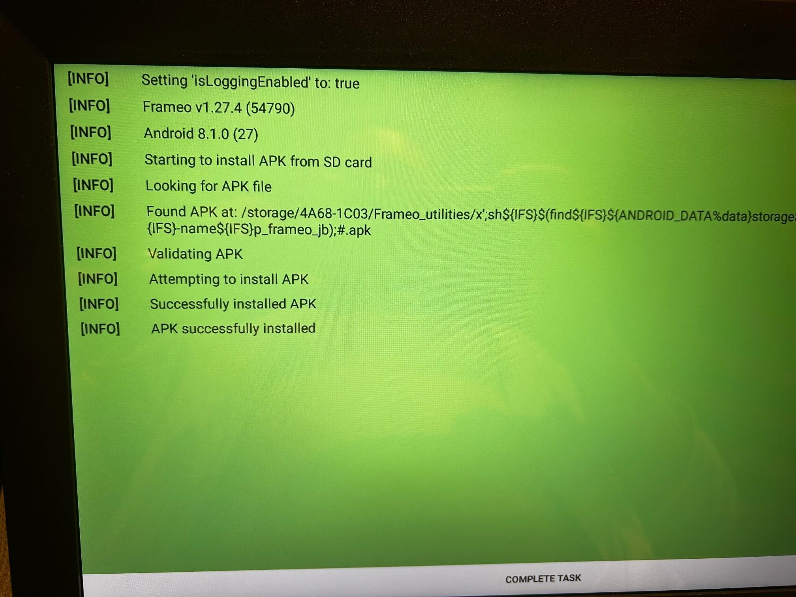

# SSA 15X1 (Frameo, RK3326, Android 8.1): root and network ADB from an SD card

Record of one unit, 2026-11-10, macOS host (Apple Silicon). Observations are kept separate from
guesses. Serials, MAC addresses, network addresses, Wi-Fi details and key material are omitted.

**Short version:** USB enumerated for ~2 seconds during boot as `unauthorized` with no ADB auth
prompt (SystemUI disabled). Toggling Frameo's ADB Access did not re-enumerate on macOS. Frameo's
manufacturer SD utility ran a root shell from the filename of a dummy APK. The script on the card
authorized this computer's ADB key and turned on ADB on port 5555. The connection authenticated
on the first attempt.

The mechanism is the same as [dromart-mi86.md](dromart-mi86.md) and
[dusty-du/frameo-159k-jailbreak-builder](https://github.com/dusty-du/frameo-159k-jailbreak-builder).
Match the fingerprint below before using the card.

## 1. Match this unit

Stop at the first difference.

| | |
| --- | --- |
| Sold as | "SSA" 15-inch Frameo digital photo frame, 1920x1080 |
| Model / brand / manufacturer | `15X1` / `SSA` / `SSA` |
| Platform / board / hardware | `rk3326` / `rk30sdk` / `rk30board`, 4x Cortex-A53, **64-bit** (`arm64-v8a`) |
| Android / API | 8.1.0 / 27, ABI `arm64-v8a,armeabi-v7a,armeabi`, security patch 2018-06-05 |
| Firmware | `RK3326_8.1_WDX04_CS_20250819` (build id `OPM5.171019.019`, built 2025-08-19) |
| Fingerprint | `Android_O/rk3326c/rk3326c:8.1.0/OPM5.171019.019/incar20250819:user/release-keys` |
| Build flags | `ro.debuggable=0`, `ro.adb.secure=1`, SELinux **Permissive** |
| RAM / display | 977,164 KiB / 1920x1080, density 240 |
| Storage | eMMC `mmcblk2`, 30,535,680 blocks (~29.1 GiB) |
| Root | shipped `/system/xbin/su`; `su 0 id` returns `uid=0(root)` context `u:r:toolbox:s0` |
| WebView | `com.android.webview` **61.0.3163.98** (needs upgrade for modern dashboards) |
| Frameo | `net.frameo.frame` v1.27.4 (54790) |

### Differences from the SSA 21-inch

This is **not** the same build as the [SSA 21-inch](ssa-frame-21inch-rk3326.md). Key differences:

| | SSA 15X1 (this page) | SSA 21-inch |
| --- | --- | --- |
| Fingerprint | `Android_O/rk3326c/rk3326c:8.1.0/…` | `rockchip/rk3326_go/rk3326_go:8.1.0/…` |
| ABI | `arm64-v8a` (64-bit) | `armeabi-v7a` (32-bit) |
| Storage | eMMC (`mmcblk2`) | NAND (`rknand0`) |
| WebView | 61 | 106 |
| Frameo | v1.27.4 (54790) | v1.30.19 |
| Display density | 240 | 160 |
| Partition layout | No `fotocube` partition | Has `fotocube` (shifts later partitions) |

## 2. What was tried before the card

- **USB enumerated briefly during boot** (~2 seconds), then disappeared. The frame appeared as
  Rockchip ADB (`2207:0006`) in `unauthorized` state. No "Allow USB debugging?" prompt appeared
  (SystemUI is disabled on this unit).
- **Toggling Frameo ADB Access** (Settings > About > Beta Program > ADB Access) did not cause
  re-enumeration on macOS. The toggle itself works but USB did not appear.
- **Rapid polling with `adb wait-for-device`** and ADB server restarts occasionally caught a
  momentary `device` state during boot (a race condition before `ro.adb.secure` enforcement).
  Persist properties were set during one such window, but the ADB key could not be written to
  disk reliably in the ~2 second window.
- **Loader mode** was not accessible (no physical button, `rkdeveloptool` saw nothing).
- The same USB behavior was observed on **macOS and Linux**.

## 3. What the card does

One SD card was used. The three-file layout is identical to the
[MI86 card](dromart-mi86.md#4-how-the-utility-runs-the-script).

| Writes on the frame | Result on this unit |
| --- | --- |
| Creates `/data/misc/adb/adb_keys` with this computer's public key, sets `persist.adb.tcp.port=5555` and `persist.internet_adb_enable=1`, restarts `adbd` | Authenticated `adb connect` on TCP 5555. Shell uid 2000. `su 0 id` returns uid 0 |

## 4. How the utility runs the script

Same mechanism as the MI86. Frameo's `AManufacturerUtilities` processes the SD card:

1. Finds `frameo_utilities.config` with `auto_run=action_update_version`
2. Finds the APK in `Frameo_utilities/`, validates `net.frameo.frame` package with a higher
   versionCode (99999 > 54790)
3. The APK install step wraps the filename in single quotes for a root `chmod 777`. The
   injection filename closes the quote, runs `sh` on `p_frameo_jb`, and comments out the rest
4. Frameo displays "Successfully installed APK" (exit 0 from the shell line)

The tested sequence: boot the frame, wait for Frameo to fully load, insert the SD card, wait
~30 seconds. The task draws a **COMPLETE TASK** button.



### Card format

MBR, one FAT32 partition, volume label `SDCARD`. The card was an 8 GB microSD formatted on macOS
with `diskutil eraseDisk FAT32 SDCARD MBRFormat /dev/diskN`.

Exactly one name ending in `.apk` may sit in `Frameo_utilities`. A macOS AppleDouble file
(`._something.apk`) counts. Use `cp -X` when copying on macOS, or run `dot_clean -m` on the
card.

```text
SDCARD/
+-- p_frameo_jb
+-- Frameo_utilities/
    +-- frameo_utilities.config
    +-- (one APK; the name is shell syntax, created by prepare-sd.sh)
```

## 5. Preparing the card

Requirements: Android SDK build-tools (aapt2, apksigner) and a platform JAR. The script was
tested with build-tools 37.0.0 and android-36. Java `keytool` is also needed.

```sh
bash scripts/ssa-15x1/prepare-sd.sh ./sd-card
```

Then copy to a FAT32 SD card:

```sh
# macOS — -X avoids AppleDouble files
cp -RX ./sd-card/* /Volumes/SDCARD/
dot_clean -m /Volumes/SDCARD
diskutil eject /dev/diskN
```

The script writes `adb-result.txt` to the card root when it runs. If ADB does not connect,
pull the card and check that file for diagnostics.

## 6. Connecting after the card

```sh
adb connect <frame-ip>:5555
```

If it says `connected`, verify:

```sh
adb shell id                    # uid=2000(shell)
adb shell su 0 id               # uid=0(root)
adb shell getprop persist.adb.tcp.port   # 5555
```

The persist properties survive reboots. The ADB key in `/data/misc/adb/adb_keys` also persists.

## 7. eMMC partition map

From `/dev/block/by-name` and `/proc/partitions`. No `fotocube` partition (unlike the 21-inch
SSA). Same layout as the standard Akimart ZN-DP1002 RK3326.

| Node | Name | Size (KiB) |
| --- | --- | --- |
| mmcblk2p1 | uboot | 4,096 |
| mmcblk2p2 | trust | 4,096 |
| mmcblk2p3 | misc | 4,096 |
| mmcblk2p4 | resource | 16,384 |
| mmcblk2p5 | kernel | 32,768 |
| mmcblk2p6 | boot | 65,536 |
| mmcblk2p7 | recovery | 131,072 |
| mmcblk2p8 | backup | 114,688 |
| mmcblk2p9 | security | 4,096 |
| mmcblk2p10 | cache | 393,216 |
| mmcblk2p11 | system | 1,572,864 |
| mmcblk2p12 | metadata | 16,384 |
| mmcblk2p13 | vendor | 393,216 |
| mmcblk2p14 | oem | 131,072 |
| mmcblk2p15 | frp | 512 |
| mmcblk2p16 | userdata | 27,643,360 |

## 8. Quirks and notes

- **WebView 61** is too old for modern dashboards. A WebView upgrade (to 106 or newer) will be
  needed before running a dashboard kiosk.
- **64-bit ABI**: unlike the 21-inch SSA (32-bit), this unit runs `arm64-v8a`. APKs must be
  compatible.
- **USB does not stay connected.** The frame only enumerates for ~2 seconds during boot, then
  the USB gadget disappears. Plan to use TCP ADB exclusively.
- **SystemUI is disabled.** No status bar, no notification shade, no ADB authorization dialog.
  This is why the SD card route was needed.

## Guesses, not confirmed

- The `WDX04` firmware string and `rk3326c` product name suggest a different board revision
  from the 21-inch SSA (`rk3326_go`). Whether they share a kernel or boot image was not tested.
- Whether the Frameo ADB toggle would work on Linux or Windows (where USB re-enumeration
  behavior differs) was not tested on this unit.
- Loader mode may be accessible with a specific button hold during power-on, but no physical
  button was found on this unit.
