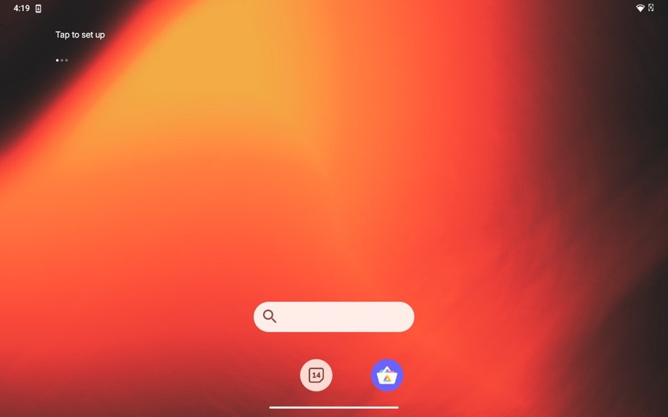
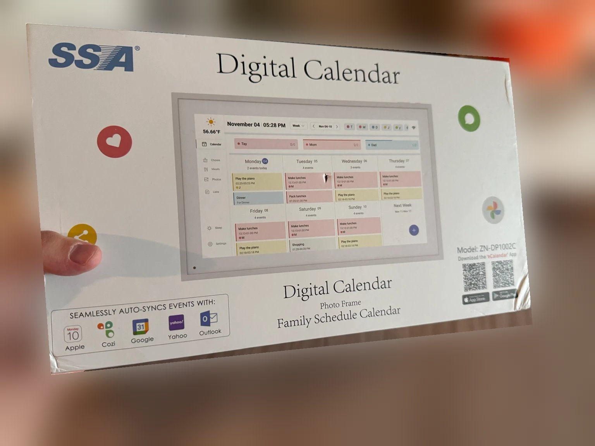
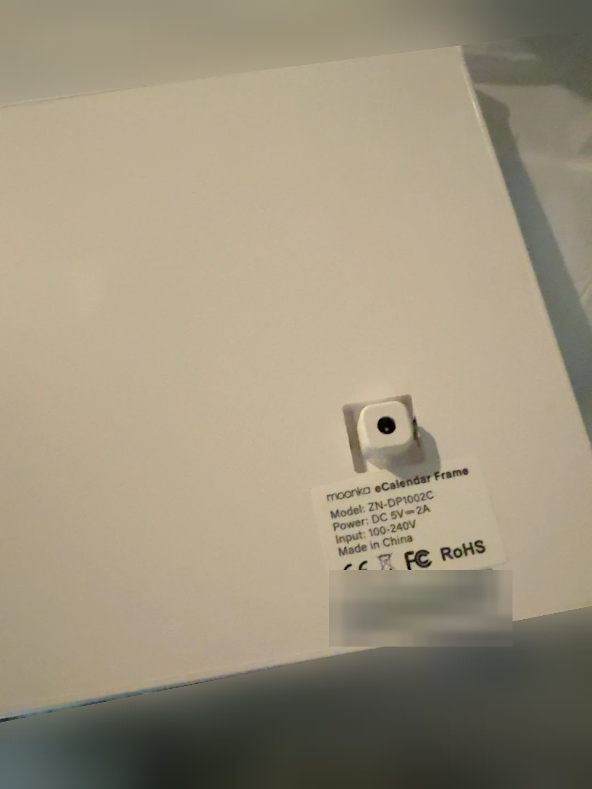
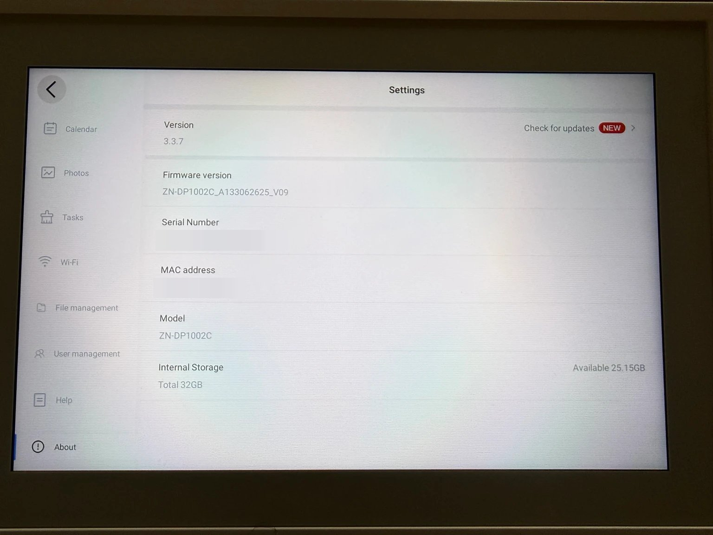
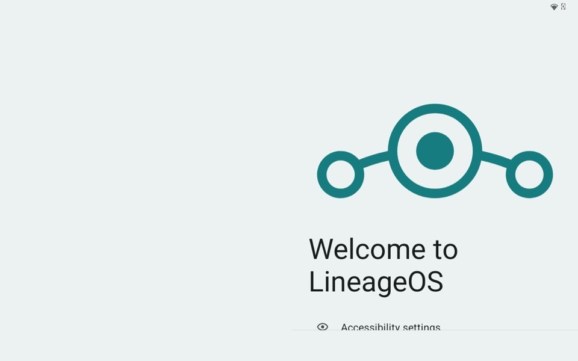

# SSA / moonka ZN-DP1002C calendar (Allwinner A133, Android 10 → LineageOS 21 / Android 14 by DSU)

See also [android14-dsu.md](android14-dsu.md) (Skylight RK3566 DSU trial).



A record of **one unit**, tested from macOS between 2026-11-08 and 2026-11-15. **Everything was done over
Wi-Fi ADB with the case closed: no teardown, no opening the enclosure, no soldering or test pads.** It is a record, not a
procedure: the tools that wrote the frame are not in this repo, and the backup taken first does not
meet the README's backup rule (see [Backup](#backup)). Check every identity value below before you copy
anything from this page.

End result: Android 14 (LineageOS 21 with Google apps) boots by default, with **Lawnchair** as Home and
gesture navigation. Stock Android 10 and its calendar stay installed and come back by themselves after a
failed Android 14 boot plus one power cycle. Outside `/data`, only `boot` (ramdisk fstab), `vbmeta` and 4
bytes of `vendor` were changed. The Android 14 system lives as a Dynamic System Update (DSU) on `/data`.

Closest relatives in this repo: the [C-2](joyhong-c2-a133.md) (same fingerprint, same vendor calendar app)
and the [LOOFII C-3](allwinner-a133-loofii-c3.md) (same A133 platform, GSI on the factory vendor). Despite
the name, this is **not** the Rockchip ZN-DP1002 in [akimart-zn-dp1002.md](akimart-zn-dp1002.md). Don't
run the Rockchip, A33 or `scripts/a133/` routes on it.

## Identity





| | Value seen on this unit |
|---|---|
| Sold as | SSA "Digital Calendar" box, model ZN-DP1002C. The back label reads **moonka eCalendar Frame**, model ZN-DP1002C, DC 5V 2A |
| Name warning | The [moonka ZN-DP1002](akimart-zn-dp1002.md#third-unit-moonka-zn-dp1002-2026-10-22-linux) in this repo is a **Rockchip RK3326 Frameo** frame. Same brand, nearly the same model name, different board. Check the firmware string |
| ADB model / product | `ZN_DP1002C` / `ceres_aw`, device `ceres-aw`, board `exdroid` |
| Firmware | `ZN-DP1002C_A133062625_V09` |
| `ro.build.fingerprint` | `Allwinner/ceres_aw/ceres-aw:10/QP1A.191105.004/eng.JOY1.20241029.195308:user/test-keys` |
| SoC | `sun50iw10p1`, four Cortex-A53 (`0x41`/`0xd03`). Allwinner A133 by platform, chip marking not inspected |
| OS | Android 10 (SDK 29), security patch 2020-11-05, kernel 4.9.170 (`CONFIG_ARM64=y`, `CONFIG_COMPAT=y`) |
| Userspace | **32-bit only**: `armeabi-v7a,armeabi`, `zygote32`, no `/system/lib64` or `/vendor/lib64` |
| RAM / storage | About 2 GB (`MemTotal` 2,021,744 kB) / 32 GB eMMC; 2 GiB dynamic `super`; `/data` is `UDISK` (`mmcblk0p17`), F2FS |
| Display | 800×1280 panel run as 1280×800 landscape, density 180 |
| GPU | PowerVR GE8300, vendor DDK `1.11@5516664`, 32-bit only |
| Touch / sensors | `gslX680` touch, `Mi3da` accelerometer, light sensor |
| WebView | 74.0.3729.186 |
| Vendor app and Home | `com.fujia.calendar/.ui.DeviceMainActivity` (eCalendar 3.16.2 in `/data/app`, factory 3.3.7 at `/system/priv-app/CloudPhotoFrame`), shares UID 1000 |
| Ports | Round DC power jack only. **No external USB port.** The case was never opened, so an internal USB connector or test pads were not checked. Android does list a USB device controller (`5100000.udc-controller`), state `DISCONNECTED`, which doesn't show whether its data lines reach anything |
| Stock boot / vbmeta SHA-256 | `d22d40aaaf540f416841edc90e47fe31dffb454aff163fba70e35d98cfc310f1` / `7a0cd4be90f7b25462c86084669caeb3c621226708dd5689c4669f9848ab3e2f` |

## Access out of the box

### Getting into Android Settings and ADB

The calendar app hides Android's own Settings. How this unit was opened up:

1. Set up the calendar normally and connect it to Wi-Fi.
2. In the calendar's settings, open its **About** page. Check that the firmware version reads
   `ZN-DP1002C_A133...` before going further.

   

3. Tap the **Model** line (the label or the model number next to it) **10 times within 5 seconds**. Android's
   regular Settings app opens.
4. In Android Settings: About tablet → tap **Build number** 7 times to show Developer options, then turn on
   **USB debugging** in Developer options. The owner did this before the first `adb connect`.
5. From a computer on the same network: `adb connect <frame-ip>:5555`. The frame's IP is in its Wi-Fi
   settings or your router's client list.

Timing matters. The app ignores a tap that comes less than 0.4 s after the previous one, and all 10 counted
taps must land within 5 s. Tap steadily, about twice per second; tapping as fast as possible doesn't work.
This comes from the decompiled calendar app (`com.fujia.calendar`, `AboutFragment.startSettings`, 10 hits in
5,000 ms; `OnCLickUtils.isClick`, 400 ms debounce). It matches the owner's memory of repeatedly tapping the
model number; the original session didn't record the exact taps. Tapping the
**Storage** line 10 times the same way tries to open a factory test app, `com.joyhong.test`.

The vendor already sets `service.adb.tcp.port=5555`. So step 4 may not be needed for network ADB, but that
was not tested: the owner turned on debugging before trying.

### What you get

- **Root ADB over Wi-Fi on TCP 5555, no key check.** `ro.adb.secure=0`, `ro.secure=0`, `ro.debuggable=1`,
  SELinux permissive. `adb connect <frame-ip>:5555` then `adb shell id` returned `uid=0(root)` and
  context `u:r:su:s0`. The frame only needs to be on Wi-Fi through the calendar's own setup.
- With no external USB port, **Wi-Fi ADB is the only known way in.** Anything that breaks Android's Wi-Fi
  or `adbd` on stock leaves no known recovery route. An internal USB port may exist; the case was not opened
  to look.
- Public FCC internal photos for SSA's DP1002 ([2A4D2-DP1002](https://fccid.io/2A4D2-DP1002/Internal-Photos/09-ZN-DP1002-IntPho-5680048),
  2022) show a **Rockchip RK3126** board with a micro-USB connector, not this A133 board. Don't use them to
  find ports on this unit.
- Anyone on the same network gets a root shell. Keep the frame on a network you trust.
- macOS: `adb connect` failed with `No route to host` on the default ADB server port while `nc` reached
  5555. Starting a second server with `adb -P 5038 ...` worked.

## Backup

Taken first, but **partial**: both calendar APKs (hashes match the device), the stock `boot` and `vbmeta`
partitions, `super`, and a live copy of private app data. No full eMMC image, `boot0`/`boot1`, or tested
restore. This does not meet the README's backup rule. With no external USB port, and the case unopened,
there is also no known way to restore a whole-disk image if Android stops booting.

## Why DSU

DSU puts the new system in files on `/data` and leaves stock `system`, `vendor` and `boot` alone. A one-shot
DSU boot that fails comes back to stock on the next boot. On a frame with no rescue port that fallback is
the main safety feature. Stock ships `gsid`, `gsi_tool` and `com.android.dynsystem`, and about 25 GiB of
`/data` was free.

GSI choice: the kernel and Binder are 64-bit, but the vendor (including the GPU driver) is 32-bit only.
Use an **`a64`** (arm32 userspace, binder64) image. An arm64 GSI would need 64-bit builds of the exact
PowerVR DDK above; none were found.

## Problems found, in the order they were hit

### 1. Streaming the image over ADB failed

`adb exec-in gsi_tool install ... < system.img` over Wi-Fi ended with `gsid: read gsi chunk: I/O error` in
the device log while the Mac reported success, and the staged image hash did not match. A retry dropped
the ADB connection. What worked: `adb push` the image to `/data/local/tmp`, check its SHA-256 on the device,
then run the stock installer detached from the ADB session with the file as its input. Android 10's
`gsi_tool` reads the image from file descriptor 1:

```sh
gsi_tool install --gsi-size <exact image bytes> --userdata-size <bytes> --wipe --no-reboot 1< system.img
```

Then compare `sha256sum /data/gsi/dsu/system_gsi.img.0000` with the source. `gsi_tool status` prints
`disabled` before the first boot even when the install is good.

### 2. Every DSU boot silently fell back to stock

Four armed reboots all came back to the calendar. The kernel log of the visible boot only said
`GSI not enabled, proceeding with normal boot`, which turned out to come from the **second** boot. A
RAM console log (pstore) caught the first one. The kernel has `CONFIG_PSTORE_RAM`; a boot image whose only
change was the command line (`mem=2040M ramoops.mem_address=0xbf800000 ramoops.mem_size=0x400000 ...`)
kept the previous boot's console across a warm reset. It showed:

```
init: Created logical partition system_gsi on device /dev/block/dm-4
init: [libfs_avb] Device path not found: /dev/block/by-name/vbmeta
init: Failed to open AvbHandle: No such file or directory
init: Failed to mount /system
reboot: Restarting system with command 'bootloader'
```

Cause: with a DSU armed, first-stage init must open `vbmeta`, but this firmware's first-stage fstab has no
`avb` entries, so the `/dev/block/by-name/vbmeta*` nodes don't exist yet. Init aborts, the one-shot marker is
already used up, and the next boot is stock. A clean stock reboot took about 7 s to the next kernel; an
armed one took about 21 s and mounted `/metadata` twice. Turning off a leftover `adb remount` overlay did
not change anything.

**Fix used on this unit:** three lines added to `fstab.sun50iw10p1` in the boot ramdisk, so init creates the
nodes. The `emmc` mounts then fail harmlessly (`ignoring mount for no_fail partition`), and stock boot does not
start depending on vbmeta.

```
/dev/block/by-name/vbmeta         /avbdev_vbmeta         emmc  defaults  first_stage_mount,nofail
/dev/block/by-name/vbmeta_system  /avbdev_vbmeta_system  emmc  defaults  first_stage_mount,nofail
/dev/block/by-name/vbmeta_vendor  /avbdev_vbmeta_vendor  emmc  defaults  first_stage_mount,nofail
```

Kernel and DTB stayed byte-identical. The other 11 ramdisk entries stayed byte-identical. The stock vbmeta is
signed with the **public AOSP test key**, so the new boot and vbmeta were signed with the same key; `avbtool
verify_image` passed. Stock top-level vbmeta flags are `1` (hashtree disabled), so the DSU mounts without
verity. Both partitions were written from the root shell after checking that the current contents hashed to
the stock values above, then read back and compared. The originals were kept on the device with a guarded
restore script. Resulting images on this unit (they also carry the ramoops command line):

| File | SHA-256 |
|---|---|
| boot with fstab fix | `3f6433ce0b886444ecd6c7602be56c9c41c230dced90beb25d284195d006dfa8` |
| matching vbmeta | `6c140de39c1c35088edaf155e6ba71bf39d2b037fd2b22809103c2b59e767902` |

### 3. Android 11+ GSIs never mounted `/data`

Next boot reached the new init and rebooted with `reboot,netbpfload-missing`. Log:
`[libfstab] ReadFstabFromFile(): failed to get active DSU slot`. Newer systems need two files that the
Android 10 installer never writes. Created from stock before each new install's first boot:

```sh
printf dsu > /metadata/gsi/dsu/active
printf userdata_gsi,system_gsi > /metadata/gsi/dsu/lp_names
```

### 4. "Black screen" was the screen asleep

Android 16 and the first Android 14 boots looked dead. **A short press of the power button woke the
display.** Expect a long blank period on a first boot (about ten minutes for the first Android 14 boot)
and press power before assuming a failure.

### 5. SystemUI crash loop, black app layer

`NullPointerException ... WallpaperManager$Globals.mService` in SystemUI. The vendor overlay
`/vendor/overlay/framework-res__auto_generated_rro_vendor.apk` turns off `config_enableWallpaperService`.
Fix: `persist.sys.phh.no_vendor_overlay=true`. Since the system can't boot to set it, it was added from
stock to the DSU's `/data/property/persistent_properties` (see [Editing DSU data from
stock](#editing-dsu-data-from-stock)). The same overlay makes Fossify and KISS crash on the **stock** system.

### 6. Fresh data has no Wi-Fi, so no ADB and no setup

The frame's saved networks were merged from stock's `/data/misc/wifi/WifiConfigStore.xml` into the DSU's
`/data/misc/apexdata/com.android.wifi/WifiConfigStore.xml`. After that the DSU joined Wi-Fi and answered
ADB at the same address. Entering Wi-Fi on screen during setup also works if touch is right (next item).

### 7. Sideways picture and wrong touch

Vendor props set `ro.surface_flinger.primary_display_orientation=ORIENTATION_90`. Stock ignores it; Android 14
obeys it. `gslX680` reports a 1920×1200 grid that doesn't follow the rotation. Fix: a 35-byte file
`/data/system/devices/idc/gslX680.idc` containing `touch.orientation = ORIENTATION_90`. With it, auto-rotate
works in both orientations from the `Mi3da` accelerometer. Also kept:
`wm set-ignore-orientation-request true` so apps can't force upside-down portrait.

### 8. Launcher crash loop, missing widgets and Recents

`ro.config.low_ram=true` in `/vendor/build.prop` removes `app_widgets`, picture-in-picture and others, and
Trebuchet/Launcher3 crash-looped. `resetprop_phh` plus a framework restart proved the cause. The value was
then changed in place in the raw `super` partition: 4 bytes `true` → `   0` (init trims the spaces), at byte
offset 805,132,006 **on this firmware only**, with the block saved before and after and read back. Stock
still booted normally with `ro.config.low_ram=0`. This is the only vendor change.

### 9. Restart notification

LineageOS's `com.android.dynsystem` posts a "running a dynamic system" notification. Its **Restart** button
turns the DSU off and boots stock. `pm disable-user --user 0 com.android.dynsystem` from inside Android 14
removed it.

## Editing DSU data from stock

**Don't loop-mount `userdata_gsi.img.0000` read-write.** It corrupted the DSU data twice (Android 14:
keystore2 `database disk image is malformed`; Android 16: unmountable F2FS). Working explanation, not proven:
writes through the file let stock F2FS move blocks, while the DSU reads the fixed extents in `lp_metadata`.

What worked every time: read the userdata extents from `/metadata/gsi/dsu/lp_metadata` (`lpdump`), build a
`dmctl create <name> linear ...` table over a loop device on the whole `UDISK` partition, and mount that with
`-o nodiscard` (writes) or `-o ro,norecovery` (reads). The extents change with every install, so rebuild the
table each time. Toybox shell arithmetic and `losetup -o` are 32-bit here; avoid byte offsets above 4 GiB.

Pulling power while a DSU system runs left its F2FS unmountable twice. Use the power menu's **Power off**.

## Android 14 image used

LineageOS 21 GSI by Andy Yan, from his [SourceForge GSI project](https://sourceforge.net/projects/andyyan-gsi/files/)
(`lineage-21-td` builds): `lineage-21.0-20261109-UNOFFICIAL-a64_bgN-signed.img`, 2,404,343,808 bytes, raw image
SHA-256 `2331a001f44e7b7cc27c9ed6ae9558b0f9013f2c60c182dd3c970e5cb5b1c483` (computed here after decompressing;
check the release's own published hash). Android 14, patch 2026-11-01, `userdebug`, Google apps included.
Installed with an 8 GiB data image. `ro.adb.secure=0` and the vendor's `service.adb.tcp.port=5555` give it root
network ADB with no key check, like stock.

Result: display, backlight, touch, auto-rotate, Wi-Fi, Google sign-in, Play services and Play Store work. Sound, Bluetooth and the microphone were not tested. SELinux is
enforcing. About 1.1 GB RAM free at idle. Play Store reports **"Device is not certified"**, and apps that ship
only arm64 code won't install on this 32-bit userspace.

## Launcher: Lawnchair

Tried on Android 14: KISS (worked, owner didn't like it), Trebuchet (crashed until the low-RAM fix, then
rejected), Fossify (worked, but its dock sat above a second white bar). That bar was LineageOS's tablet
taskbar from `com.android.launcher3`, not the launcher.

Final setup:

- [Lawnchair 14 Beta 3](https://github.com/LawnchairLauncher/lawnchair/releases/tag/v14.0.0-beta3), APK SHA-256
  `b1cc5bc468bbc5fc26a0107e348149dac349fd0247dca40f290bfd11b78957db`, installed with `adb install` and set
  as the default Home (`app.lawnchair/.LawnchairLauncher`).
- Gesture navigation: overlay `com.android.internal.systemui.navbar.gestural` (`navigation_mode=2`). The wide
  three-button taskbar becomes a thin line.
- Taskbar off: `settings --lineage put system enable_taskbar 0`, then force-stop `com.android.launcher3`.
- **Keep Launcher3 enabled.** It provides Recents for the swipe-up gesture.

Settings survived restarts. Undo: set Home back to Launcher3 or uninstall Lawnchair.

## Making Android 14 the default boot

A plain `gsi_tool enable` lasts one boot here. Android 14's `gsid run-startup-tasks` deletes
`/metadata/gsi/dsu/install_status` and `one_shot_boot` on every boot, because the Android 10 installer never
writes `<slot>/complete`. Writing `complete`/`ok` to make it permanent was rejected: a broken Android 14 would
then have no way back on a frame with no USB port.

What this unit runs: the GSI's own root hook, `/system/bin/phh-on-boot.sh` (runs on
`sys.boot_completed=1`), was changed so that, while a marker file `/metadata/gsi/dsu/a14_default` exists, it
re-arms a single boot (`install_status` = `0`, restores `dsu/install_dir`) **only after a boot completes**.
Stock init then boots Android 14 again. A boot that never completes leaves no marker, and the next power
cycle boots stock. The script was the same size as the original, so only one 4 KiB block of the DSU system
image changed. It was written in place from stock through the raw extents, with the old and new blocks
saved and the patched image hash checked.

Tested: re-arm on three boots; a restart from Android 14 returns to Android 14 in about 110 s; a forced failed
boot hung on the boot animation, and one power cycle returned to the stock calendar. Not tested: the off
switch (remove `a14_default`, restart twice), a power cut while Android 14 runs, and an early failure before
`gsid` runs. `dsu/install_dir` must exist when Android 14 boots; without it `gsid` writes `ok`, which is
permanent with no fallback.

To re-arm by hand from stock after a fallback:

```sh
cd /metadata/gsi/dsu
printf disabled > install_status
gsi_tool enable
cp lp_metadata install_dir dsu/
```

## What did not work

- **Android 16** (LineageOS 23.2 `a64_bvN4` community build, two dates): one build booted fully but was never
  seen on screen (probably the sleeping display). The other showed the bootloader logo, then black, and the
  power button did not wake it. Not debuggable; dropped.
- **8 GiB fresh DSU data next to an existing DSU:** `gsid` refused: `File is too fragmented, needs more than 512
  extents`. Worked after deleting the old DSU first.
- **arm64-only apps** (an ML photo-frame app with only an `arm64_v8a` split): `INSTALL_FAILED_NO_MATCHING_ABIS`.
  No 64-bit vendor GPU driver exists for this board as far as was found.
- **Restart from the power menu** before the fixes did nothing; Power off restarted. Not re-tested after.

## Security notes

- Stock and this Android 14 build both give root ADB on TCP 5555 to anyone on the network, with no key.
  Treat the frame as having no security and keep it on a trusted or isolated network.
- The GSI updates the Android framework only. Kernel 4.9.170, the bootloader and vendor drivers are unchanged.

## Guesses, not confirmed

- Other ZN-DP1002C units may ship different firmware or boards. Match the fingerprint and firmware string.
- The C-2 shares this exact `ro.build.fingerprint`. Its DSU path may hit the same missing-vbmeta-node problem.
- The [Benibela JT101M](benibela-jt101m-a133.md) note "DSU attempts did not boot" may have the same cause as
  [problem 2](#2-every-dsu-boot-silently-fell-back-to-stock). Not checked on that unit.


